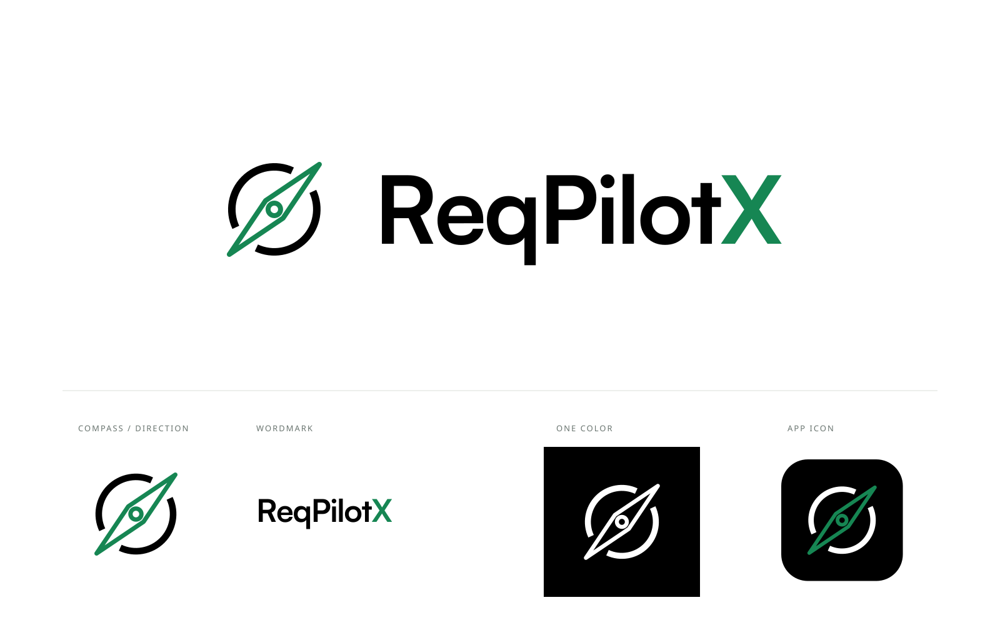

# ReqPilotX · Green Compass v7

Selected design asset set, approved on 2026-10-31. This directory archives the approved identity only; it does not replace the application's current assets, UI tokens, company branding, or `MASTER.md`.

## Selected treatment

- Flat diagonal compass: interrupted circular ring, outlined double-ended needle and circular pivot.
- Needle/pivot outline and the final **X** share **#168653**.
- Ring and remaining letters are **#000000** on light backgrounds or **#FFFFFF** on dark backgrounds.
- Geometry, proportions and placement match the approved monochrome v6; v7 changes colors only.
- No gradients, glass, bevels, lighting, or shadows. This is ReqPilotX identity, not a Vercel or Schaeffler trademark.

## Files and use

Each SVG has a matching PNG. Prefer SVG for scalable display; the logo wordmark is outlined and has no runtime font dependency.

| Asset | Use |
| --- | --- |
| `ReqPilotX-lockup-green` | Primary horizontal combination on white/light backgrounds |
| `ReqPilotX-lockup-green-reverse` | White ring/text with green needle/X on black/dark backgrounds |
| `ReqPilotX-symbol-green` / `green-reverse` | Standalone symbol, matching light/dark surface |
| `ReqPilotX-lockup-mono` / `white` | Fully black or fully white single-color combination |
| `ReqPilotX-symbol-mono` / `white` | Fully black or fully white symbol |
| `ReqPilotX-wordmark` | Black wordmark with green X |
| `ReqPilotX-app-icon` | Flat black rounded-square tile with white ring and green needle |
| `ReqPilotX-Identity-Green-Compass` | Presentation preview, not a production UI component |

Keep aspect ratio and existing stroke weights. Do not stretch, rotate, re-space the letters, add effects, or recolor individual parts. Light variants include a white pivot interior; dark variants include a black pivot interior, so select the matching surface. PNG backgrounds outside the artwork are transparent except the app tile and presentation board. Use the single-color alternative when accent color cannot be reproduced. At very small sizes the center detail becomes less distinct; inspect at the intended physical display size before application integration.

## Typography and rights

The wordmark uses **Satoshi Bold**, from [Fontshare / Indian Type Foundry](https://www.fontshare.com/fonts/satoshi), with coordinated letter spacing; it is not a newly invented font. Only this finished wordmark artwork is included, not font software or a reusable alphabet.

Official [ITF Free Font License (FFL)](https://www.fontshare.com/licenses/itf-ffl), version 2.0 dated 2026-08-17, checked on 2026-10-31: Section 01 permits personal/commercial creative works including logos, wordmarks and vector files; the Definitions distinguish such normal-use artwork from modified font software. Font-file modification and redistribution remain restricted. Anyone needing the font itself should obtain it directly from Fontshare and review the current license. No font files are bundled here.

This archive does not grant third parties a new trademark license. No trademark clearance or registration has been performed. Public repository availability does not establish registrability or exclusivity.

## Provenance and verification

Created and refined through Superdesign, with deterministic SVG export and outlined wordmark. Selected version: v7. The preview is rendered from SVG, not a browser screenshot. Light and dark presentations were visually checked. No application source code was changed or deployed as part of this asset archive.

Excluded: account/authentication state, CLI configuration, generation scripts, user-supplied reference imagery, private conversation content, and font binaries.
