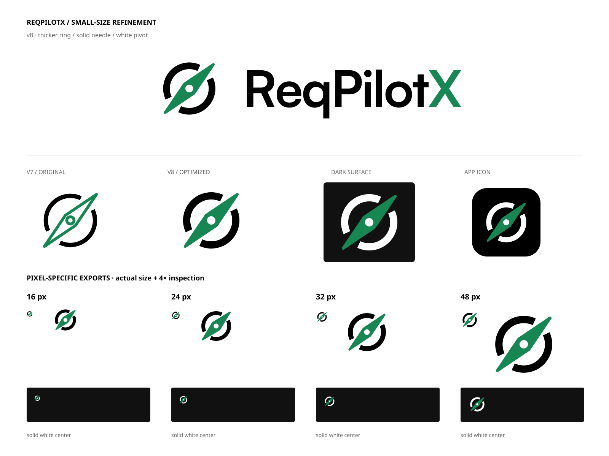

# ReqPilotX v8 · 小尺寸优化套件

基于已确认的 green-compass-v7 原始 SVG 精确修改，不重新设计品牌。已确认的 v8 设计资产归档；当前资产目录仅保留 v8；旧版可从 Git 历史查看。本次只归档资产，不修改运行应用、不替换旧 UI 资源，不同步在线设计画布。

## 改动

- 外圆线宽从 6 增至 10（100 单位坐标），提高小尺寸的外轮廓稳定性。
- 双尖指针填充品牌绿 `#168653`，保留斜向与原有端点。
- 中心圆改为实心白色，不是透明挖孔；深色背景下仍为白色。
- `ReqPilotX` 字标路径、字距和绿色 X 保持原版，不改字体或字形。
- 无渐变、阴影、立体或玻璃效果。

## 目录与选择

- `assets/master/`：可缩放 SVG 与对应大尺寸 PNG，包括绿针主版、深底反白绿针版、单色黑/白、字标、组合标志、App 图标。
- `assets/optical/`：16 / 24 / 32 / 48 px 的独立 SVG 和精确尺寸 PNG，适合工具栏、标签页和列表图标。小图标应直接选择对应文件，不要从大图反复缩放。
- `previews/ReqPilotX-v8-Comparison.png`：原版/新版、组合字标、明暗底与尺寸对比。
- `previews/ReqPilotX-v8-Pixel-Proof.png`：实际导出 PNG 的 1:1 像素及最近邻放大检查；不是重新按矢量放大后冒充像素效果。

### 光学处理

16 px：外环线宽 11.5、稍紧的 viewBox（4 4 92 92）、针中段略加宽、白色轴心半径 7.5。24 px：viewBox（2 2 96 96）、中段略加宽、轴心半径 6.5。32 / 48 px 使用标准母版几何，轴心半径 5.8。端点方向、品牌绿及圆环基本结构均保持一致。

16 px 是极小栅格，斜边仍会有正常抗锯齿；优先使用配套专用文件。若空间允许，24 px 及以上能更清晰保留中心圆细节。高 DPI 界面优先用对应 optical SVG，按目标 CSS 尺寸显示。

### 明暗底与透明度

`green` 为黑色圆环，用于浅底；`green-reverse` 为白色圆环，用于深底。两者都是同一绿色实心针与白色中心圆。背景透明，但白色轴心是有意保留的不透明白色。`mono` 是黑色单色标志/白轴心；`white` 是白色单色标志/黑轴心，用于纯单色场景，避免白针与白轴心混为一体。App 图标包含固定黑色圆角底板。

## 验证

所有 SVG 均经解析并直接渲染 PNG。检查了 16/24/32/48 px、浅底/深底、透明边角与白色中心像素；组合字标的每条字体路径与 v7 一致。最终渲染图已实际视觉查看。没有声称已经完成应用内或用户设备上的验收。

## 来源与字体

原始资产来自 ReqPilotX 固定提交 `45a00e136f9f76e5086ddc5a88dffc7439dd522c`，目录 `design-system/reqpilotx/brand/green-compass-v7/`。

字标沿用 Satoshi Bold（Fontshare / Indian Type Foundry）转曲作品，不包含字体软件或新的字母表。原版已核对的官方许可来源：<https://www.fontshare.com/fonts/satoshi> 与 <https://www.fontshare.com/licenses/itf-ffl>。需要字体文件者应从 Fontshare 获取并查阅当时适用条款。此套件不进行商标注册、近似检索或额外授权承诺。
