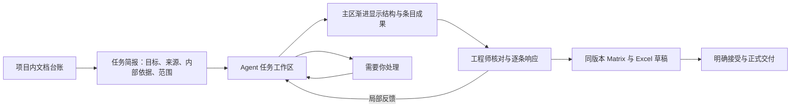

# ReqPilotX Agent 原生工作台：整体评估与方案

日期：2026-09-10。状态：**用户已授权继续；首轮实施与验证见[实施记录](Agent原生工作台首轮实施与验证.md)**。范围为现有桌面工作台从上传到交付的功能、信息架构、交互和视觉；沿用当前产品模型与来源合同，不更改已保存客户成果。

方法：dual-agent，A 为 `/root/workflow_design_assessment` 的独立设计评估，B 为 `/root/workflow_implementation_assessment` 的实现/检测评估；A 完成后才合并 B 的检测发现。主 Agent 实查用户当前结构页、复核关键代码，并调查 Beautiful UI 及官方产品/设计文档。结论是启发式评估，未开展真实用户可用性实验。

## 1. 先回答核心问题

**推荐“文档台账＋同源条目表格＋按需来源核对＋统一 Agent 任务区”。** 文档和跨条目审阅应明显向表格转变；结构核对保留树；Agent 的目标、当前动作、待决定问题、成果与反馈归到同一任务。仅换配色、增加动画或把所有内容塞进聊天框，都不能完成这次升级。

| 问题 | 结论 |
|---|---|
| 上一轮到底改了什么？ | 改了中性侧栏、工具栏和树行样式，重排协作浮层的状态/成果/输入，修复窄屏与焦点。没有重做上传、文档台账、完整任务入口、状态来源与主导航。 |
| 为什么不明显？ | 用户当前打开的是“原文结构”；该页仍是原来的阶段条、三栏核对、运行轨迹和技术操作。上一轮最大的交互变化在“清单审阅”的协作浮层，覆盖面和入口均不够。 |
| 直接做成 table 更好吗？ | 文档管理和跨条目审阅更适合；原文结构、完整原表和单条证据不适合统一平铺。推荐同源的表格/结构阅读视图，按任务选择默认视图。 |
| 固定 Approval Card 是否合适？ | 适合固定“需要你处理”的位置，并在确有待决定事项时显示卡片；不应把每个技术步骤变成必经审批。启动说明、澄清、正式确认需分清。 |
| 运行轨迹能否移除？ | 可以移除独立的一级入口；公开工作记录并入 Agent 任务区，成果历史随版本保留，技术诊断按需展开。现有几条数据来源不能直接拼成一条假连续历史。 |
| Agent native 最重要的改动？ | 让用户始终知道“目标是什么、正在做什么、已经得到什么、现在需要我做什么”，并能在同一上下文检查和纠正结果。 |

## 2. 现状评估：问题不只在外观

### 2.1 应保留的产品能力

现有特色是原文层级、SRC/REQ、完整条目、派生与 PDF 精确位置可共同核对；树有键盘导航、搜索、筛选和可调整栏宽；工作版、人工意见与来源校验有实际实现。它已经具有工程工作台的核心，不需要另造一套聊天应用或第二份需求存储。产品约束见 [PRODUCT.md](../../PRODUCT.md) 和 [模型 V1](文档结构与原文条目模型V1.md)。

### 2.2 五项优先问题

| 优先级 | 实查问题 | 用户受到的影响 | 推荐修复 |
|---|---|---|---|
| P1 | 项目页显示等待整理/需求 0，同一 E01 工作账本已有 v14、448 原文/328 需求；“进入需求提取”默认进入 diagnose | 以为没有成果，可能再次处理；看不懂同一文档到底完成到哪一步 | 统一来源级成果摘要；区分工作版与已确认清单；默认打开最近可核对成果或当前任务 |
| P1 | 结构页显示“本轮结构已生成”，阶段条同时突出“理解全文范围”；协作与运行轨迹另读不同数据 | 无法判断正在运行、已结束、待确认还是已有旧版成果 | 分开呈现任务状态、成果状态、审阅状态，统一读取规则 |
| P1 | 项目/来源三栏占位大，单一来源行被拉高；缺少版本、任务、需处理、更新时间等横向可比信息 | 长列表难找、难比较，进入下一步成本高 | 项目搜索/最近项目＋文档 Records Table；选中后按需预览 |
| P1 | 分析模式仍主要呈现“原文审阅”；建议重复原文，人工意见藏在较下方；反馈入口有多套 | 工程师花时间找决定入口，而不是判断证据与响应 | 分析以待处理队列和响应区为中心，原文随手展开；统一自然语言反馈，人工结论独立清楚 |
| P2 | 导出首先列对象数量，未决响应只在次要文字中；原生工作版与旧确认版本的交付能力不同 | “已分析”容易被理解为可正式交付 | 先显示交付用途、版本和未决项，再列内容/格式；草稿与正式交付分别表达 |

具体代码：
- [项目状态与入口](../../prototype/frontend/src/features/projects/ProjectManagementPanel.tsx)：约 730 行的可用版本判断、911 行的 `checkpoint: diagnose`；来源列表约 563 行。
- [结构/清单核对与轨迹](../../prototype/frontend/src/features/extraction/NativeStructureReferenceDock.tsx)：约 4378–4530 行；原生任务协作仅在部分模式挂载。
- [当前工作版分析/导出分支](../../prototype/frontend/src/features/workspace/SourceItemWorkspace.tsx)：8–57 行；[分析响应呈现](../../prototype/frontend/src/features/extraction/SourceItemReasoning.tsx)。
- [当前任务空状态](../../prototype/frontend/src/features/extraction/RequirementTreePanel.tsx)：约 2695 行和 7986 行。

实景来自历史 E01 v14，不把其中封面多个 SRC、历史缺证据分析等语义问题归因于本轮样式。表格不会自动修正错误粒度；来源问题仍须在对应版本显式修订，不能在 UI 静默删行或改号。

### 2.3 启发式评分

独立设计评估为 **24/40**，说明已有可用基础，但完整工作链需要明显改善。每项 0–4；分数不是用户实验、业务准确率或生产就绪度。

| 准则 | 分数 | 主要依据 |
|---|---:|---|
| 系统状态可见 | 2 | 跨页数量和阶段状态不一致 |
| 符合用户语言 | 2 | 原文之外仍露出内部容器名和技术标识 |
| 用户控制与退出 | 3 | 暂停/继续/关闭/范围控制有实现，运行中行为本次未执行 |
| 一致性 | 2 | 任务、原生账本、旧确认清单混用不同呈现路径 |
| 错误预防 | 3 | 来源/版本校验和草稿保护有基础 |
| 识别优于记忆 | 2 | “当前文档/已选条目”缺具体身份，旧目标不显露 |
| 灵活与效率 | 3 | 树导航、搜索、栏宽可用，批量扫描不足 |
| 视觉与简洁 | 2 | 色彩克制，信息层级和空间利用仍弱 |
| 错误识别与恢复 | 3 | 有保留成果和重试机制，完整故障流程本次未写入测试 |
| 帮助与引导 | 2 | 有局部说明，缺少依据当前成果组织的下一步 |

新手主要卡在默认诊断页和“重新解析/快速读取/补全/继续”的区别；工程师主要卡在多种反馈入口和来源遮挡；负责人主要缺少跨文档进展和未决集合。认知负荷集中在这些具体决策点，不应靠删掉领域信息来降低。

## 3. 参考调查：哪些值得采用

Beautiful UI 是组件呈现参考，并不提供 ReqPilotX 的业务状态机。以下“落地方式”是本次设计建议，不是该网站对工程需求系统的规定。

| 参考组件 | 在 ReqPilotX 中的落点 | 落地重点 |
|---|---|---|
| [Records Table](https://www.beautifului.dev/#records-table) | 项目内文档台账、条目审阅表 | 稳定列、行选择、列宽、状态、来源链接 |
| [Filter Table](https://www.beautifului.dev/#filter-table) | 文档状态入口、工程师审阅队列 | 明确筛选范围与数量口径；支持组合与清空 |
| [Task Rows](https://www.beautifului.dev/#task-rows) | 一次任务的当前工作与阶段成果 | 行内真实状态和可打开成果，不以工具次数代替完成度 |
| [Approval Card](https://www.beautifului.dev/#approval-card) | 确需用户决定的结构确认、澄清、正式交付 | 对象、范围、依据、确认后动作和结果回执 |
| [Loading State](https://www.beautifului.dev/#loading-state) | 上传校验、载入工作版、Agent 等待 | 区分短请求与长任务，保留已有内容 |
| [Thinking](https://www.beautifului.dev/#thinking-state) | 公开工作说明与按需动作详情 | 仅展示真实公开摘要/动作，不补造隐藏思维链 |
| [Streaming Text](https://www.beautifului.dev/#streaming-text) | Agent 的公开进展与答复 | 与来源引用相连；消息流和正式成果分别处理 |
| [Tool Chips](https://www.beautifului.dev/#tool-chips) | 聚合读取、检索、校验、保存动作 | 默认显示工作含义，技术调用名称进详情 |
| [Context Cards](https://www.beautifului.dev/#context-cards) / [Prompt Bar](https://www.beautifului.dev/#prompt-bar) | 来源依据与范围明确的输入区 | 显示实际文件、版本、SRC/REQ；保留草稿 |
| [Diff Table](https://www.beautifului.dev/#diff-table) / [Selection Actions](https://www.beautifului.dev/#selection-actions) | 修订比较、选中范围交给 Agent | 保留旧值/新值/理由/来源；动作不隐式扩大范围 |

其他参考补足“如何工作”：

- [Linear Agent interaction](https://linear.app/developers/agent-interaction)：将会话、活动、等待输入和成果放在任务上下文内。本项目可借鉴任务与活动的关系，不照搬它用最后一个活动驱动状态的实现；工程成果状态需要独立证据。
- [Carbon Data table](https://carbondesignsystem.com/components/data-table/usage/)：工具栏、选择、批量动作和按需详情的成熟组织方式。借鉴密度与渐进披露，避免每行塞入全文、图表和全部操作。
- [Vercel AI Elements Confirmation](https://elements.ai-sdk.dev/components/confirmation) 与 [Reasoning](https://elements.ai-sdk.dev/components/reasoning)：确认的请求/处理结果、工作说明的展开收起值得参考。当前项目是 React/Vite 和自有服务，不需要为套组件更换整个技术栈。
- Microsoft HAX 的[能力说明](https://www.microsoft.com/en-us/haxtoolkit/guideline/make-clear-what-the-system-can-do/)和[高效纠错](https://www.microsoft.com/en-us/haxtoolkit/guideline/support-efficient-correction/)：启动时说明会得到什么，发现局部错误时容易纠正和恢复。
- [WAI Treegrid](https://www.w3.org/WAI/ARIA/apg/patterns/treegrid/)：层级表格的焦点、选择、展开是需要完整实现的交互。只加 `role=grid` 并不会获得键盘能力。
- [AG-UI events](https://docs.ag-ui.com/concepts/events)：消息增量与状态快照/增量应分开。可借鉴事件分类；是否采用协议包可后定，不把它设为 UI 改造前置。
- 工程模型参考 [PTC Document Structure](https://support.ptc.com/help/windchillrvs/r13.0.0.0/en/IntegrityHelp/client_docs_what_is_a_document.mif-2.html) 的结构/内容区分。本项目继续按模型 V1 保留文档结构、来源条目与关系，不由表格组件重新解释。

不建议当前优先引入通用流程画布、Agent 屏幕直播、装饰性置信度仪表或模型切换面板；先解决目标、状态、成果、范围与人工决定的闭环。

## 4. 目标信息架构与工作链

### 4.1 以项目、文档和任务组织

全局入口保留项目搜索/最近项目；项目内主导航建议为 **文档、工作台、交付**，设置为次级。文档下明确区分“客户文档”和“内部知识”。独立 AI 阅读继续可用，从文档行进入，不默认为正式提取前置步骤。

进入工作台后，顶部显示项目/文件名/来源版本/当前工作版，主体切换“结构核对、条目审阅、响应分析”。这三项是同一份成果的不同工作视图；不再要求用户在全局侧栏按技术流水线逐个找页面。任务历史按来源与版本查找，不能仅靠 latest 覆盖所有旧任务。

图表达业务关系，不规定 Agent 的固定工具顺序；正式交付部分按已具备的版本能力显示，缺少原生合同的部分列为后续增量。

### 4.2 从上传到交付的目标体验

| 环节 | 用户主要动作 | 应显示什么 | 下一步如何出现 |
|---|---|---|---|
| 选择项目 | 搜索或打开最近项目 | 项目名、客户、最近工作 | 进入该项目文档台账 |
| 上传客户文档 | 添加或拖入文件 | 每文件传输/校验/失败状态、来源角色 | 保存成功的行出现“设置任务/打开成果” |
| 组织文档 | 指定主文档、附件关系或版本 | 文件身份、已保存成果、进行中任务 | 合理默认值加可修改关系，歧义才询问 |
| 发起任务 | 确认简短目标与范围 | 预期成果、内部依据、结构确认偏好、拆分授权范围 | 一个明确“开始处理”动作 |
| Agent 处理 | 可继续看原件、切文件、补充意见 | 当前动作、真实耗时、已有成果、剩余问题 | 新成果进入主区，给“新增内容”提示 |
| 结构核对 | 检查章节、表格、图片与所属 | 结构树、完整内容、原页 | 需要结构确认时显示关联该版的卡片 |
| 条目审阅 | 筛选、比较、定位、提出修订 | 同源条目表格、分类、变化、来源 | 对当前条目/所选集合发反馈 |
| 响应分析 | 查内部依据、作人工决定 | 建议、证据、缺口、有效响应及决定人 | 待处理队列逐项推进；无依据按政策跳过自动符合性分析 |
| 交付 | 选择用途与范围并下载 | 工作版、响应版本、未决项、包含内容 | 草稿可下载；正式交付满足对应合同后显示 |

上传能力应准确表达：目前有多文件队列、真实上传进度、失败重试与格式/大小校验；关闭上传对话框后的继续不等于浏览器彻底关闭后的断点续传。允许保存某种格式也不等于该格式的完整 Agent 工作链已经验收。PDF 仍为当前优先路线。

## 5. 表格方案：更明显，也更适合批量工作

### 5.1 三种方案比较

| 方案 | 好处 | 代价 | 决定 |
|---|---|---|---|
| 全部普通表格 | 列对齐、筛选方便 | 抹平结构/共享条件，全文和原表挤入单元格 | 不作为全产品方案 |
| 保持树为所有页面主视图 | 结构与逐条核对熟悉 | 横向比较、批量筛选和项目管理低效 | 不足以满足本轮诉求 |
| 文档表格＋同源条目表格＋结构/证据视图 | 同时支持扫描、批量与细读 | 需要统一选择/范围/状态和详情呈现 | **推荐** |

### 5.2 文档台账

默认列建议：`选择｜文件名｜文件版本｜已有成果｜当前任务｜需处理｜最近更新｜打开`。

“已有成果”显示如“结构草稿 / 原文工作版 vN / 响应草稿”；“当前任务”显示如“排队 / 整理结构 / 待你确认 / 暂停”。两列可以同时成立：旧版可审阅，新一轮仍在运行。

状态入口采用 `全部 / 需处理 / 处理中 / 可审阅 / 异常` 的视觉组织。若它们是独立筛选集合，明确可能重叠；不要把这些数字相加作为文档总数。批量入口支持对明确选择的文件发起同类任务，选择“当前页”与“全部筛选结果”必须区别；重复上传的复用/新版本政策须有后端身份依据。

选中行后按需打开文件详情或预览。单行固定在适当高度，不再随列表剩余空间拉高；项目长列表以搜索与最近记录解决。

### 5.3 条目审阅表

默认列建议：`选择｜原编号 / SRC / REQ｜原文内容摘要｜内容判定 / 类别｜响应状态｜依据 / 决定来源｜需处理`。完整版本与来源范围在表上方明确，少用每行重复的长元数据。

必须保留的规则：

- “原序”模式按后端真实来源顺序，章节/逻辑表作为可折叠分组；纯标题不因有表格行就获得 SRC。真实 1:1 共用行，1:N 才展开多条。
- “工作队列”模式可按状态/分类筛选与分组，行内或详情仍能回到完整路径与原序。显示编号不作为稳定主键。
- 单击打开详情，复选框表示批量范围，二者不混为同一种选择。批量操作栏显示准确范围和数量。
- 原文列可预览，但完整义务、条件、例外、原表和图片在详情可看全；不让摘要代替客户原文，也不把原表拼成文本。
- 分类、重点提示、响应状态、AI 建议/人工决定分别表达。“重点”不是“不符合”，“待证据”不是“已通过”。
- 全部 / 重点 / 需关注 / 本次变化等是不同工作视图；派生单一需求和来源父项保留明确关系，分析分母按真实分析单元计算。
- 切树/表、开关 PDF、筛选和到达新版本时保留选择及草稿；新版本到达先提示，不突然替换用户正在审阅的版本。
- 导出“全量”或“当前筛选”显式选择；折叠和滚动位置不自动改变导出范围。

### 5.4 避免四栏同时争夺空间

默认批量审阅为“主表格＋按需详情”。打开证据时进入“紧凑列表＋条目/响应＋PDF”的专注核对布局。Agent 是可停靠的任务区，不再用 440px 浮层覆盖关键原文。

在宽屏可让任务区与主表共存；在 1024–1299px 使用主区标签切换或受控的侧面板，保证待决定事项与任务状态有稳定入口。不要固定同时铺开项目导航、树、表格、条目、PDF和聊天六个区域。

## 6. 引导与 Approval Card：固定位置，按需决定

建议在 Agent 任务区顶部设“需要你处理”。它支持三种内容，不都叫批准：

| 类型 | 何时出现 | 具体内容 | 操作 |
|---|---|---|---|
| 任务简报 | 新文档准备开始，或用户主动新建目标 | 来源、目标、内部依据、范围与输出 | 修改设置、开始处理 |
| 澄清问题 | 确有来源歧义、缺附件或决策差异 | 问题、影响范围、可选处理及其他可继续工作 | 回答、跳过该受影响范围（确实允许时） |
| 确认卡 | 用户设置的结构确认点，或正式接受/发布 | 精确成果版本、可查看依据、未决项、确认后效果 | 查看成果、补充修改、确认此版本 |

固定位置能让用户知道去哪里找下一步；卡片由真实待决定对象驱动。例行读取、保存可逆工作草稿、已授权局部修订不增加逐次审批。

结构确认示意文案：

> 文档结构草稿已可核对。确认后将基于这一版继续提取原文条目。范围：〈实际文件与版本〉；尚未处理：〈真实未决范围〉。
> **查看结构与来源**　**提出结构修改**　**确认此结构并继续**

卡片应绑定 question/decision ID、source/map/baseline、范围与后续命令；刷新后恢复，已回答后显示回执，版本变化后提示该问题已过期。重复点击或网络响应未知时复用同一未决命令身份；不能因超时默认视为同意。结构确认只表示该结构检查点已确认，不等于每条需求接受或报价承诺。

## 7. Loading、Thinking、Streaming 的设计

### 7.1 状态显示应来自真实事实

| 场景 | 推荐呈现 | 数据依据和限制 |
|---|---|---|
| 上传 | 文件行进度条 | 已传输字节/总字节；100% 之后单独显示服务端校验 |
| 打开已有成果 | 对应列/区域 skeleton，旧内容可保留 | 请求状态；未返回数值用待加载，不能先显示 0 |
| 已排队 | 队列标签＋任务已保存回执 | durable job 已受理，不显示 Agent 正在思考 |
| 读取材料 | “正在读取…〈实际范围〉”＋工具标签 | 真实读操作/回执；没有页号则不编页号 |
| 理解与规划 | 紧凑“正在处理/整理…”＋公开进展摘要 | 仅在运行事实成立时显示；不展示或虚构隐藏思维链 |
| 校验/保存 | “正在核对来源 / 正在保存工作版” | 真实校验/发布操作，成功后给成果链接 |
| 新成果到达 | 主区出现已保存行/节点，提示新增内容 | 有效、来源绑定的成果事件；局部结果标清范围 |
| 等待用户 | 固定待处理卡，任务无继续动画 | 真实确认/澄清请求及可继续范围 |
| 请求暂停 / 已暂停 | 两个独立状态，保留成果入口 | 已受理暂停不等于 worker 已停止 |
| 同步异常 | “状态暂未同步，最近更新于…” | 连接未知不能冒充任务失败或持续运行 |
| 本轮结束 | 本轮摘要、成果、仍未完成的内容、下一步 | 队列终态、业务结果、成果保存分别解释 |

建议展示真实“已运行时长”和“最近更新时间”。没有可靠分母时不用百分比或预计剩余时间。页面打开了 35 页不等于语义核对了 35 页；工具调用完成不等于条目判断已通过。

Thinking 的视觉可以借鉴折叠状态行；用户展开后看到“已查什么、发现什么、接下来需要核对什么”的公开工作记录。分类依据是面向工程师的证据与理由，仍放在相应条目，不能用泛化思考文本替代。

### 7.2 三种流分别处理

1. **公开消息流**：Agent 进展与答复渐进显示，按 message ID 组装。用户上滚阅读时停止自动滚底；新内容用提示引导，不抢输入焦点。
2. **工具/活动流**：开始、完成、失败聚合为一条活动；默认展示工作含义，调用参数/日志按需。事件重放去重且保持真实来源和顺序。
3. **成果流**：主区增量显示经过保存/校验的结构节点和条目。未完成 JSON、尚未绑定来源或未通过校验的模型片段不直接变成正式台账行。

当前主要是 HTTP 轮询，尚不是端到端 token streaming。第一增量先用现有 poll 把完整历史和阶段成果接正确；随后可补服务端事件/消息增量。采用 SSE 可减少等待，但不能代替状态、游标、重复事件和版本冲突的正确处理。[AG-UI 的消息与状态事件区分](https://docs.ag-ui.com/concepts/events)可作为合同参考，不要求先迁移运行框架。

## 8. 运行轨迹与 Agent 协作怎样整合

当前三个区域的事实来源不同：

| 当前区域 | 实际职责与来源 | 目标去向 |
|---|---|---|
| Agent 协作 | 真实 task/job/thread/turn；start/steer/interrupt/resume；loop/events 和任务结果 | 统一任务区的控制与公开活动 |
| 运行轨迹 | 结构 handoff/native-reference 活动；条目 run_receipts 摘要与 scope job | 对应成果的生成记录，挂到相关任务/版本，保留来源标识 |
| AgentWorkflowCockpit | props 驱动；部分文案由页面 readiness、checkpoint 等推导 | 可复用外壳，状态改接统一任务摘要 |

**推荐移除独立“运行轨迹”按钮。** 在同一任务区按“当前工作、成果、需要你处理、补充意见”组织；“工作记录”按需展开，“技术诊断”再下一层。不能删掉持久审计和故障定位能力，也不能给来自旧工件的记录补造时间或任务身份。

必要修复：终态 loop 当前只请求首批事件（默认 100 条），然后停止轮询，界面保留该批最后 40 条并称“近期记录”。本次 E01/r17 第一页后仍有第二批 100 条。应先顺 cursor 读到当前末尾，或提供明确的尾部接口；再切实时增量。该问题在上一轮外观调整时没有发现，必须纳入本次方案的首批工作。

依据：[SourceItemAgentLoop](../../prototype/frontend/src/features/extraction/SourceItemAgentLoop.tsx) 约 94–121 行；[事件读取](../../prototype/app/application/agent_workflow/source_item_loop_jobs.py) 474–552 行；[run receipt 摘要](../../prototype/app/application/agent_workflow/source_requirement_reference_bridge.py) 588–619 行。

## 9. 响应分析、反馈与交付

响应分析先回答四件事：客户要求是什么、内部依据是什么、当前建议/有效响应是什么、还需工程师决定什么。建议区压缩重复引用，通过来源链接回看完整原文；用户仍可同时打开 PDF。

反馈入口统一为“交给 Agent 核对/修改”，明确范围为本条、所选条目、当前章节或文档；章节范围须绑定真实结构 ID，不能假造尚不存在的 SRC。草稿范围固定显示，选择变化不静默改变已写意见的对象。**工程师直接作响应/覆盖判断**保留独立显式动作，不伪装成给 Agent 的聊天意见。

修订结果用 Diff Table/条目差异呈现：旧值、新值、变更原因、来源、受影响范围和结果版本。可逆工作建议与正式接受按当前授权规则处理，不强迫所有条目逐条点批准。

交付页主结论应为“可下载何种用途的哪一版”。先显示待证据、待澄清、过期判断等真实集合，并可跳回处理；再说明全量/筛选范围、原表/原图、派生和有效响应的包含规则。工作版 Excel 继续由同版程序生成。原生工作版的正式历史/锁定/FORMAL 尚需完整合同；不能将旧 Requirement Set 分支的能力直接贴成当前原生任务已经具备。

## 10. 实现评估：复用什么，补什么

| 类别 | 现有基础 / 缺口 | 实施方式 |
|---|---|---|
| 直接复用 | 原件保存、持久队列、同线程继续、阶段保存/确认、范围反馈、人工意见、SourceItem 账本、程序 Excel | 保持后端业务核心，重组入口和纯呈现组件 |
| 增加统一读取层 | task/job/runtime/业务结果/成果/待决定对象分别存在；多个页面各自推导状态 | 形成文档工作区共享 TaskView 和 DeliverySummary，明确来源与状态优先规则 |
| 表格适配 | delivery snapshot 与 outline 可共用有序 source ledger；旧 Matrix 组件绑定 legacy set | 提取纯 Matrix presenter，加 native adapter，写操作沿用 SourceItem/engineer API |
| 阶段来源投影 | MAP/ITEMS 已存，但当前阶段预览以文字为主，表格 cell 被拼成 source_text | 补 tree/table/image/locator 读取，主区复用成熟原表/PDF组件 |
| 事件正确性 | loop 字节 cursor、旧 activity sequence、任务身份与消息分别存在 | 区分记录来源，补完整历史、去重、重连、末尾判断及业务活动类型 |
| 命令回执 | 后端已有多种幂等机制；前端每次点击新建 UUID；确认跨运行状态缺统一重放收据 | 保存未决命令 ID，复用到结果确定；逐类验证 start/confirm/steer/resume |
| 后续底层能力 | 原生多版本台账、指定版本读取/比较、正式接受与锁定、交付历史未完整统一 | 单独增量定义来源和响应谱系，不在 UI 层假装完成 |

TaskView 至少携带：真实任务身份、目标、source/version、scope、队列/运行/业务状态、已有成果引用、待决定问题、允许的控制动作、最近更新时间和事件游标。模型目标在服务端保存过，但现有前端类型/界面未充分显露，应补读投影。

工程成果和任务失败可以同时存在。本次 r17 GET 看到队列 `FAILED`、runtime `COMPLETED` 和已保存的 42 项 Map，并有运行身份漂移错误；应显示“本轮未完成，已有结构草稿可核对”，而不是用单个“完成”覆盖所有事实。此处是读取到的现有状态，不是本次评估触发的故障。

现有数据/导出共用关系见 [source_item_delivery_bridge.py](../../prototype/app/application/agent_workflow/source_item_delivery_bridge.py) 和 [source_item_delivery.py](../../prototype/app/application/agent_workflow/source_item_delivery.py)。当前源工作版不能冒充 legacy `requirementSetId`。

## 11. 推荐推进顺序与完成判据

| 增量 | 工作内容 | 可审查结果与完成判据 |
|---|---|---|
| A：任务与成果连起来 | 统一文档状态、默认成果落点；修终态事件补齐、未决命令身份；将主区成果和任务区贯通 | 同一文档各页显示一致；失败/暂停仍能打开已保存成果；不先落技术诊断；历史确实读到尾部 |
| B：文档与审阅表格 | 文档 Records Table、条目表格/结构视图、Filter Table 风格队列；固定明确上下文的输入 | 搜索/筛选/批量范围明确；树表同 ID/顺序/版本/响应；单条完整来源随手核对 |
| C：引导与运行体验 | TaskBrief/澄清/Approval Card、真实 Loading/Thinking、公开消息与活动流、阶段增量 | 确认绑定准确版本；无依据分支清楚；新成果不抢焦点/跳滚动；断线重连不重复或漏记录 |
| D：响应与交付闭环 | 决策优先的分析区、差异核对、未决集合与交付摘要；按能力补原生版本历史/正式交付 | 人工决定与 AI 建议分明；同版 UI/Excel 一致；草稿和正式交付用途清楚 |

A/B/C 可以围绕同一文档迭代，但先保证来源与状态一致，再增加视觉状态。Q17 的范围保存/恢复能力继续作为基础，不把 UI 研究变成重建 App Server 或更换数据层的理由。当前开发计划不因这份建议自动改写。

第一个可交付切片建议覆盖：**添加 PDF → 文档台账出现 → 任务简报 → 真实任务状态 → 结构草稿直接显示 → 指定确认/局部意见 → 条目表格 → 同版 Excel 草稿**。用既有成果验证读取与呈现，用隔离的合成任务验证控制和错误路径，再用授权新文档完成真实语义验收。

## 12. 验收办法与尚待确认的选择

下面是拟定验收条件，不是本次测量结果：

- 新手不用理解 parser、handoff 或 Document Map，就能找出当前来源、任务目标、已有成果和下一步。
- 已有工作版的文档不显示成“无结果”；打开即落到成果，进行中任务明确说明当前读取的是哪一版。
- 处理两个文件、一项失败、缺内部依据、Map 待确认、网络中断、刷新恢复、重复点击、来源版本变化均有明确分支。
- 条目批量范围、过滤计数、父项/派生分析分母与导出范围一致；长表、合并单元格、图片、深层结构不被平铺破坏。
- 用户在阅读旧结果或输入时，新消息/新成果不抢焦点、不自动替换版本、不改变未发送意见的范围。
- 1920/1440/1024 宽度、675 高度、键盘、明暗主题和 reduced-motion 都检查；本次五屏评估只重新核对了实际宽屏，上一轮窄屏证据另存，不混作本轮验证。
- 记录首次可核对成果耗时、需要人工追问进度的次数、完成一次局部反馈的操作数、断线恢复成功率、UI/Excel 不一致数。先建立实测基线，再约定目标，不编造提升百分比。

建议评审以下三项方案选择：①文档管理用表格、条目用表格/结构双视图；②Agent 协作采用可停靠任务区，移除独立轨迹入口；③固定待处理区域，但确认点由实际授权和待决定问题驱动。其余颜色、字号和圆角可在此方向下直接实现，不必先逐项决策。

## 13. 本次调查证据与边界

- A：项目、结构、清单、分析、导出五屏及协作浮层只读查看；代码和截图共同支撑设计结论。
- B：独立代码/GET核验。detector 扫描 features 128 文件，只有 1 项 `side-tab` warning（`KnowledgeBaselineLens.tsx:163` 的引文彩色边界）；这是低价值视觉提醒/潜在误报，不能推导工作流没有其他问题。
- 浏览器只读 evaluate 不支持检测器脚本注入，未创建 overlay；使用 CLI、真实页面和源码作为证据。没有新开服务器、worker或模型任务，没有上传、确认、继续、暂停或提交意见。
- 本次没有重跑业务测试。上一轮通过的测试证明当时变更范围，不证明这里所有建议或现有完整产品体验已经通过。
- 私有实景与技术回执：`prototype/runtime-data/ui-assessment-20260910/`，其中 `root/current-structure.png`、`design-a/`、`implementation-b/assessment-b.md`、`e01-read-api.json`、`r17-read-api.json`、`detector.json`。客户正文与运行回执留在忽略目录，不进入公共源码或研究引用。

参考资料均于 2026-09-10 访问；上述公开链接支撑交互模式与实现原则，具体 ReqPilotX 设计选择由本次实景、产品模型和业务目标推导。
