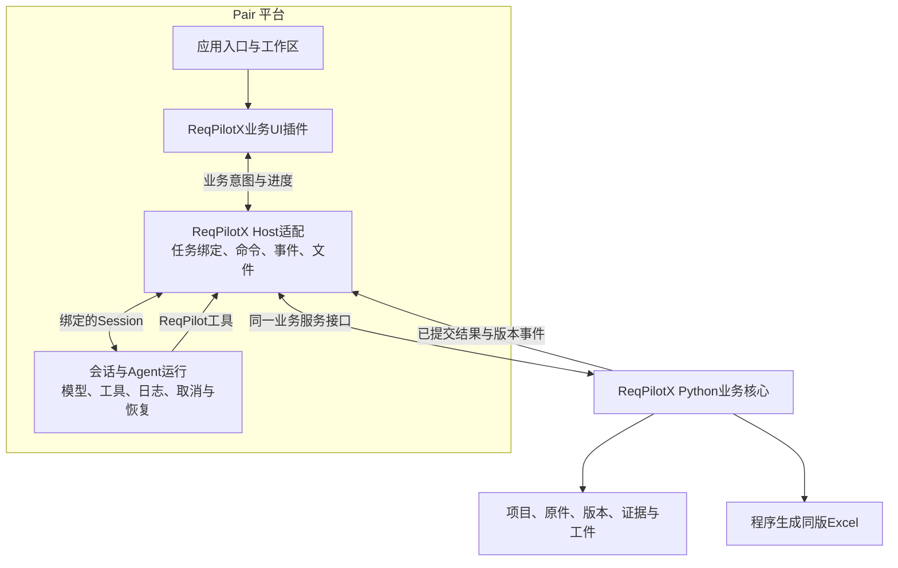

# ReqPilotX 作为 Pair 首个应用插件

更新：2026-09-14。用户明确将Pair作为目标平台，希望将ReqPilotX整体作为首个Pair应用插件，并复用已有原生业务UI。本记录定义当前产品实施目标；已有组件挂载探针，完整Pair托管应用未完成。

## 当前状态与目标

**用户纠正（2026-09-14）：3081“粘贴工作台链接”的实现仅是组件/协议技术探针，不是用户认可的ReqPilotX DSH应用插件首版。之前将服务生命周期推迟到P3、先交外部服务查看器的实施顺序偏离目标，以下新顺序替代旧顺序。**

产品从Pair启动：安装/启用插件后，由Pair宿主插件检查依赖、启动或恢复它拥有的ReqPilotX业务服务及存储连接，自动分配/发现端点并注入UI和工具。Python可保持独立子进程，但生命周期、就绪状态和关闭/恢复由Pair掌握；用户不需要先开ReqPilotX网站、执行后端命令、填端口或粘贴工作链接。连接企业已有服务是可选部署方式，不是默认个人应用流程。

正常入口是Pair侧栏ReqPilotX中的项目和文档，或Pair对话中的已授权任务。新建项目/导入原件后，程序建立业务工作和Pair会话绑定；阶段成果、原文查看、反馈与同版导出均在该上下文里可达。内部URL及work/revision只作为机器引用，不能让用户搬运。

用户进一步明确同步是重点：采用[共用能力与DSH插件同步约定](跨宿主共源与DSH插件同步约定.md)。原生Agent设计是一份共同执行设计，便携包和DSH bundle是宿主出口；不维护三套业务workflow。先核对现状分叉与版本/协议边界，可与只读UI技术验证并行。

目前已有便携能力包/headless验证，以及修正后Pair托管服务和原生项目/PDF入口：插件默认启动自有数据库/API，常用Pair侧栏可建项目和导入原文；停止与恢复已验证。**Agent任务绑定/执行及完整交付尚未通过Pair前端闭环验收**。

目标插件包含业务UI、业务服务、Agent preset/skills/tools、会话与工件绑定、运行依赖和安装生命周期。完整产品范围仍包括项目/多文档、原文阅读、结构、需求与分类、授权派生、内部证据、响应与人工意见、版本和Excel；首切片先贯通PDF整理与交付，不能把现有提取包等同于完整应用分发。

Pair作为用户入口和Agent运行平台；ReqPilotX保持独立业务核心及产品身份。Codex继续用于开发和对照验证，已有App Server证据与成果保留，后续主线不再以继续扩展Codex运行入口为前置。

## 建议界面

Pair侧边导航增加“ReqPilotX”。业务主区域复用现有结构/原文/表格/PDF/矩阵组件；Pair会话作为该任务的协作入口，可切换、收起，最终支持与业务面板同屏。小屏按当前任务优先显示业务内容或会话，不把所有栏永久挤在同一屏。

现有ReqPilotX外层的独立应用导航、全局设置和启动入口需要适配宿主；业务项目管理、知识库、评审等功能仍保留。**Pair Workspace是文件/执行容器，不等于ReqPilotX客户项目；二者通过引用绑定。**

首版可先让业务面板和指定Pair会话可靠往返并保持选择；同屏会话能力在平台层补齐或通过已验证的会话组件绑定实现。不得重新写一套不受Pair管理的聊天和Agent执行器。

## 已核实的Pair扩展点

| 能力 | 本地代码事实 | 本方案用法/限制 |
|---|---|---|
| 原生业务入口 | `ui-sidebar`的`sidebar.panellist`对应`ui-layout`的`main` keyed slot；`ctx.layout.selectPanel(id)`选择面板 | 注册ReqPilotX主面板，不替换Pair整页root |
| 前端插件分发 | 包的`dsh.client`与`./client`导出，宿主加载构建产物 | 应用插件交付Node Host与浏览器Client两部分；遵守实际Pair版本兼容约定 |
| 会话控制 | `api/session-controller`支持创建、恢复、prompt、取消与follow；部分读取不会启动Agent | 业务“开始/继续/反馈/中止”走真实Pair会话控制，并保留请求幂等与Session身份 |
| 面板绑定缺口 | 非conversation的main面板不自动得到Session绑定；`ui-sidebar-right`只在Conversation选中时渲染Session子树 | 不能宣称主业务面板与原有右栏可以直接同屏；需明确绑定指定Session并补通用呈现能力 |
| 布局工具 | `ui-dockkit`是内部布局引擎，不是稳定插件服务API | 使用宿主公开slots/services，不直接耦合内部LayoutState或操作日志 |
| AI Hub参考 | `pair-ai-hub`提供静态目录iframe及原生任务草稿准备 | 可以借鉴安装/Client注册；它不负责执行业务，不能当作现成应用运行容器 |
| PDF/大文件 | Hub静态资源有16MiB限制，通用Session文件引用常有20MiB限制且不处理Range | 业务原件通道要明确支持授权读取、Range、PDF worker与下载；不能默认复用目录展示通道 |

Pair当前Web包声明React 18；ReqPilotX前端为React 19.2.8。Pair模块系统要求共享React等基线模块，因此必须验证/适配组件与依赖版本，避免把两套React作为普通组件混用。这里是兼容性待验，不预先假定必须重写全部UI或升级整个平台。

## 目标结构

应用插件的Host负责启动或连接ReqPilotX服务、依赖检查、工作绑定、事件转换与资产传输。Python核心负责来源、Map、SRC/REQ、分类/派生、证据和人工意见、版本/冲突及导出。UI按钮和Agent工具进入同一业务命令处理，不能各写一套成果。

先复用现有Python服务与存储接口。当前依赖PostgreSQL的部分应明确作为运行依赖管理或连接已有服务，不在本轮顺带更换数据库或改写为TypeScript。插件连接的既有服务与插件自行启动的进程要区分所有权，停用时仅处理自身拥有的运行资源。

## 必须统一的四个合同

### 1. 工作与会话身份

持久化绑定至少包含Pair workspace/session、ReqPilotX project/document/work、原件hash、所查看/所编辑的result revision和实际运行标识。会话不直接替代业务工作；一个工作可有多次运行或后续会话，但同时写入必须经过已有版本校验。

用户仅查看条目，不自动触发模型或把整页内容灌入聊天。明确提出问题/反馈时，程序携带选中对象及版本引用，工具按需读取原文和必要上下文。历史成果仍可查看，不因当前会话切换而误写另一个任务。

### 2. Agent角色与工具

提供ReqPilotX业务preset，说明角色、业务用途、默认自主交付目标、当前任务和可用环境。复用共同skill/reference以及现有高层业务工具。Pair承担运行、模型配置和中止/恢复，业务阶段与完成条件由ReqPilotX定义。

阅读方法保持自由：可用PDF文本、按页MD、高清图、裁切及必要脚本。程序承担路径/编号/模板/提交/导出。通用读文件、视觉和必要执行工具按任务需要保留，不将Agent限制为既定解析器输出。模型按当前用户选择使用Qwen High，Luna Max作为对照；平台绑定不改变共用语义标准。

### 3. 双向交互与进度

- “正在读取”“正在整理结构”等状态来自真实工具/操作生命周期；已保存成果由业务提交事件驱动，不根据聊天措辞猜测。
- UI订阅最小进度与版本事件，按需要读取受影响节点；不在每个token或每次选择时重载全文。
- 用户可直接在业务UI标记问题/编辑决定；操作保留准确对象和版本，通过同一业务写入口提交。需要Agent修订时，将明确反馈送到绑定会话，允许自主继续授权范围。
- 默认不中途索取逐阶段确认；显式“先确认结构”策略继续支持。刷新或重连以已保存业务版本与Session状态恢复，断线不重跑已有提取。

### 4. 工件和文件

沿用一个项目多个文档、文档内多个任务的实体目录和固定工件类型。业务索引拥有来源、Map、条目、释读、派生、响应、发现和交付版本；Pair保留运行日志，两者用引用关联，不互相冒充权威。

成果卡由真实提交/交付回执自动生成，并可打开准确work/revision。前端通过Pair通道访问原件与业务服务，API基址由适配层提供，不写死开发端口18080。原文PDF、图片及Excel需要流式/范围读取与下载支持。关闭会话或卸载插件不会顺带删除客户项目及工件。

## UI复用的具体工作

从`prototype/frontend/src/app/App.tsx`与`WorkspacePage`中提取可由宿主挂载的业务入口，注入导航、API/文件访问、主题及任务/会话动作。当前App直接读取浏览器地址，main.tsx创建独立React root并加载全局CSS，不能原样塞入Pair组件树。

UI会话已完成[代码依据的接入评估](Pair原生业务面板UI接入评估20260914.md)。除API基址，还要覆盖XHR上传、EventSource、下载fetch及PDF/crop裸地址；只读成果加载不能再强依赖旧aiSetup/runtime readiness。阅读模块现有独立问答会话也需接到Pair绑定会话。静态检查未见明显React19专属调用，但尚未以React18实际构建验证。

复用结构树、原文详情、表格审阅、PDF定位、需求/派生和矩阵组件；样式限定在业务容器，弹层/Portal的挂载位置也要受控。Pair负责自己的外壳，ReqPilotX保留业务呈现。实际兼容验证通过后再确定组件库构建方式，不能仅凭双方都用React就宣称可直接安装。

iframe可用作短期隔离展示或视觉对照，但不作为完整应用插件完成标志。它保留独立导航/会话/地址/事件边界，需要额外桥接才能形成真实人机协作；现有AI Hub的静态只读iframe策略也不能原封不动承载可写业务工作台。

## 实施切片与验收

| 切片 | 交付 | 完成证据 |
|---|---|---|
| T0 技术探针（已完成） | React18共享组件、DSH安装/slots、只读连接、PDF定位 | 3081开发夹具与4项测试；证明技术接缝可用，不是产品首版，不计用户验收 |
| P0 Pair托管运行基础（开发机已验证） | 插件启用→依赖/数据目录检查→启动或恢复自有服务→就绪；动态端点供UI与工具使用；停用/重开遵守所有权 | 从已关闭自有ReqPilotX服务的Pair开始，仅启用插件即可就绪；不需用户手动启动外部站点；原项目保留、不影响别的服务；不因打开页面而运行模型 |
| P1 首个完整产品路径 | Pair内项目/文档列表、新建/导入、自动work-session绑定、共享skill/tools、自主执行及阶段成果、原文核对、同版Excel | 用户从Pair导入一份PDF，发起整理，得到完整成果；零粘贴内部link/ID/端口，零开发者补工件；可选反馈后同版修订；Pair重开恢复项目和任务 |
| P2 完整业务扩展 | 内部知识、符合性分析、人工意见/接受、多文档协同、既有数据迁移 | 单一共用业务合同逐项验收，未提供内部依据时按共同业务规则处理，不静默丢字段 |
| P3 发布与跨平台 | 自包含安装包、依赖分发、升级迁移、兼容矩阵 | 新环境可安装使用；验证Web/Desktop及操作系统范围，不能将基本服务托管延期到本阶段 |

主Agent已实现并验证P0托管启动/存储/动态端点及P1项目/文档入口，复用T0组件和代理；接下来补P1的Agent任务启动和自动会话绑定。粘贴link只留在开发验证夹具，不进入默认产品入口。现有开发机证据见[验收记录](Pair设计委派与验收20260914.md)，不代表独立发行包或完整P1已完成。先基于Pair Web做完整使用路径，同屏会话布局可后补，但会话绑定/任务启动不得依赖用户搬链接。

正在进行的PEF测试继续使用既有18080/55472及冻结实现；本线不重载或接管这些进程。托管生命周期验证使用独立、明确归属的运行资源，不能把已有评测服务误认作插件自有资源。新的付费完整模型验证仍由评测线统筹，不重复启动。

## 分工与当前边界

本任务负责整体合同、业务服务/工具、工作绑定、运行包和评测。现有“升级工作台UI为Agent Native”会话负责组件拆壳和交互适配，已共同确认原生main面板、显式Session绑定、controller/内容视图拆分等方向，详细代码证据见UI接入评估。Pair侧的平台改动遵循其项目规则，并限定为可复用扩展点；ReqPilotX领域模型不搬入Pair核心。

建议应用插件发行工程放在ReqPilotX仓库独立的Pair集成目录，依赖Pair公开接口；平台通用扩展在Pair维护，避免复制整套业务代码到两个仓库。具体包名/目录在开始实现时按现有包约定确定，本轮不预先伪造已存在的包或API。

原生嵌入改善交互、环境配置和工件流转，不自动解决模型首响应等待或语义错误。保留已有source-grounded评测，后续只跑Luna Max/Pair Qwen High；完整Pair前端闭环必须实际验证，headless结果不能替代它。

代码依据：Pair的`ui-layout`、`ui-sidebar`、`ui-sidebar-right`、`modules`、`ui-renderer`、`api/session-controller`、`pair/ai-hub`及`bundle/pair-web`；ReqPilotX的`App.tsx`、`WorkspacePage.tsx`、frontend/package.json及现有业务服务。以上已存在能力与待实施项在本文分别标明。
