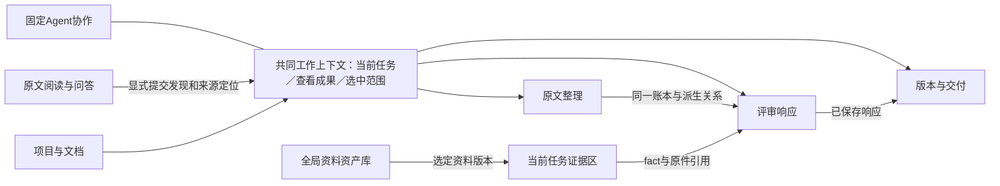

# 工作台断链与职责重叠：根因分析

日期：2026-09-12。范围：用户指出的 AI 辅助阅读、领域知识库、需求提取、需求分析，以及提取内部的冗余。方法：三条独立代码调查、主任务实际页面对照、原生阶段导航最小组件复现。本轮只做诊断与设计边界建议，没有把建议写成已实现功能，没有运行模型或修改客户成果。

后续状态：用户已授权继续实施。阶段导航、案例三态、整理／响应动作边界、阅读共同外壳及插件草稿交接已形成首个修复增量，见[实施记录](工作台职责收敛与阅读交接实施20260912.md)。下文保留修复前的诊断与证据，不作为这些部分当前仍未修改的声明。

## 核心结论

当前工作台统一了部分外壳和来源校验，但**工作对象、页面职责、动作协议与成果交接没有同时统一**。六个并列导航混合了全局资料管理、阅读工具、成果加工、工程评审和交付；部分页面因此脱离当前任务，另一些页面则拥有几乎相同的操作集合。

上轮23项修复解决了创建、跳转、异步状态、键盘和布局等具体错误。那些回归不能证明“阅读发现能进入同一条款评审”“上传知识能从图谱选入当前分析”“一个动作只有一个清晰执行归属”。本次发现包括上轮未覆盖的语义映射和原生阶段导航问题，不以此前测试数否定用户感受。

## 一、用户看到的断点与实际结构

| 用户感受 | 已证实的实现 | 根因 |
|---|---|---|
| AI阅读像另一个应用 | App直接挂载ReadingWorkspacePage，绕开WorkspaceProvider、WorkspaceShell和DocumentWorkSurface | 独立阅读器的早期产品边界继续控制入口；后续统一壳只覆盖提取／分析／导出 |
| 阅读里找不到当前任务和核对版本 | reading路由不保留pluginSessionId/resultRevision；阅读会话绑定source/capture/conversation | 原件身份保留，但当前工程工作的身份没有交接；返回时恢复localStorage不是在阅读中拥有相同工作上下文 |
| 知识库不像当前项目资料 | 图谱读打包KNOWLEDGE_SPACES；项目内部知识预览仅跳到task=knowledge | 参考资产、项目知识文件、分析事实目录三套对象缺少UI桥接 |
| 提取和分析很像 | 同一Dock与Reasoning组件；purpose主要切换顺序、队列和展示；原生两页都能拆分与分析 | 页面名称划了职责，但动作能力没有按职责划分 |
| 提取内部重复 | 阶段导航、工作版视图、阶段预览、条款／节点反馈、连续Agent任务同时存在 | 工件、视图、命令和执行阶段被做成多组平行入口，没有确定主入口 |
| 改样式后仍像拼接 | reading有独立reader token与布局；知识页自建inline工具栏/侧栏/Canvas；工作台样式只覆盖部分范围 | 视觉分叉是页面组合方式和业务边界分叉的外在表现 |

早期定义直接写明“独立 AI 阅读器……和正式提取平级”，同时要求不同业务对象不必拥有不同页面；这说明隔离正式写入是合理要求，但被实现为连应用外壳与查看上下文一起隔离。见[PRODUCT.md第27—30行](../../PRODUCT.md)。当前用户反馈要求重新收敛这层产品边界。

## 二、AI阅读：保存了原件身份，未接住当前工程工作

### 证实事实

1. [App.tsx:44](../../prototype/frontend/src/app/App.tsx)、[App.tsx:52](../../prototype/frontend/src/app/App.tsx)单独挂载阅读页；[DocumentWorkSurface.tsx:16](../../prototype/frontend/src/features/workspace/DocumentWorkSurface.tsx)只允许extraction/analysis/export。阅读另建头部与页面，见[ReadingWorkspacePage.tsx:2428](../../prototype/frontend/src/features/reading/ReadingWorkspacePage.tsx)。
2. [route.ts:105](../../prototype/frontend/src/features/workspace/route.ts)仅为上述三类任务保留plugin查看身份，reading还去掉requirementSetId。阅读API以项目／文档获取context，见[readingApi.ts:193](../../prototype/frontend/src/features/reading/readingApi.ts)。
3. 阅读发送进入conversation messages及`generate_chat`，见[readingApi.ts:266](../../prototype/frontend/src/features/reading/readingApi.ts)和[reading.py:614](../../prototype/app/application/reading.py)。固定协作使用task/start/steer/resume/interrupt，见[SourceItemAgentLoop.tsx:207](../../prototype/frontend/src/features/extraction/SourceItemAgentLoop.tsx)。两个外观相似的输入框不具有相同动作效果。
4. 阅读结构从SourceIR的`build_reading_projection`生成，并不消费已保存Map/需求语义，见[reading_projection.py:57](../../prototype/app/application/reading_projection.py)。合成案例阅读投影显示25条线索，已保存Map为22节点；这不能仅凭数量差判断哪份错误，但两者确实不是同一成果。
5. 阅读笔记有source_ref且真实持久化，见[reading.py:360](../../prototype/app/application/reading.py)；当前回答操作是引用定位、重新回答、追问，未发现“交给当前任务／关联当前条款”的显式出口。不得将此描述为阅读内容完全没有保存。

### 用户后果与设计边界

用户在v2核对过程中去阅读，能读到同一原件，却看不到“这次阅读服务于哪个任务、哪个工作版、哪条需求”；阅读发现留在另一个会话里，通常还要重新组织文字、回工作台另发一次。

应保留全文／选区问答、翻译、引用、阅读历史、笔记与可读性检查。统一外壳、来源栏和共同查看上下文；提供带来源与范围的“加入待核对发现／交给当前任务”。对话答案仍不能隐式变成客户需求、内部证据或正式工程师响应。

## 三、知识库：参考图谱、项目文件、分析证据没有在界面上闭环

| 对象 | 当前来源 | 当前实际连接 |
|---|---|---|
| 领域参考案例 | 随前端打包的Markdown、词条关系、引用摘录及benchmark cases；加上当页临时预览 | 图谱搜索和节点浏览 |
| 项目内部知识 | `/knowledge-documents`的文件记录、原件对象、SHA、生命周期和角色字段 | 后端能读取原件形成知识事实 |
| 分析证据目录 | `project-knowledge-facts/v1`，含文档、fact_id、引句、位置和catalog SHA | 原生分析输入及输出引用校验 |

真实上传→证据→分析的后端链路已经存在，见[knowledge_facts.py:19](../../prototype/app/application/knowledge_facts.py)、[source_item_agent_jobs.py:232](../../prototype/app/application/agent_workflow/source_item_agent_jobs.py)、[source_item_analysis.py:408](../../prototype/app/application/agent_workflow/source_item_analysis.py)。**未连接向量检索不等于上传原件不能形成证据，也不能把整个知识能力说成mock。**

实际断点：

- [KnowledgeGraphWorkbench.tsx:17](../../prototype/frontend/src/features/knowledge/KnowledgeGraphWorkbench.tsx)只读取knowledgeSpace及打包数据，不读取当前项目上传清单。内部知识预览的下一步只跳`task=knowledge`，没有文档／事实／当前条款参数，见[ProjectDocumentLibrary.tsx:103](../../prototype/frontend/src/features/projects/ProjectDocumentLibrary.tsx)。
- 后端可限定`knowledge_document_ids`，前端分析启动未提供资料选择；结果中的引用目前是引句、文件名、页号，没有打开对应知识原件的动作，见[SourceItemReasoning.tsx:91](../../prototype/frontend/src/features/extraction/SourceItemReasoning.tsx)和[SourceItemReasoning.tsx:284](../../prototype/frontend/src/features/extraction/SourceItemReasoning.tsx)。
- 上传UI只发送文件、REFERENCE、ACTIVE，见[client.ts:222](../../prototype/frontend/src/shared/api/client.ts)。服务端支持authority/claim_role/applicability/版本等信息；缺失时不能自动成为适格合规证据。页面没有把“已保存文件”和“本次可用证据”清楚连起来。
- 图谱Inspector的“客户需求合规判定”来自静态案例，非当前选中SOR条款的评审结果；[KnowledgeInspector.tsx:172](../../prototype/frontend/src/features/knowledge/KnowledgeInspector.tsx)把所有非COMPLIANT都显示为“需技术偏离”。原数据case-emc-03为CLARIFY（[knowledgeData.ts:709](../../prototype/frontend/src/features/knowledge/knowledgeData.ts)），已在真实页面观察到被显示为“需技术偏离”。这是需优先修复的语义错误。
- “追踪因果链”调用Wiki关系的无向最短路径；不连通时还返回起终点，见[ForceGraphCanvas.tsx:23](../../prototype/frontend/src/features/knowledge/ForceGraphCanvas.tsx)。它最多表示词条关联，不能当作工程因果或验证证明链。

应分清全局资料资产库与当前任务的证据工具。资产库管理规范、基线、DVP、案例和版本；当前任务证据区携带条款、选定资料版本、适用性与真实引用，支持回查原件和返回原条款。图谱保留为可选探索方式，不能替代证据选择和适格性判断。

## 四、提取与分析：数据共用正确，职责边界没有落实

### 实际动作矩阵

| 动作 | 原生提取清单 | 原生分析 | 插件提取清单／分析 |
|---|---|---|---|
| 查看完整原文与分类 | 有 | 有 | 两者均有 |
| 检查拆分 | 有 | 同一动作 | 均可查看，执行禁用 |
| 单条／批量符合性分析 | 有，批量入口放在“分析操作” | 同一动作，另有响应队列 | 队列／已有结果可读，当前完整写入能力未接 |
| 工程师响应 | 选派生行即可进入响应编辑 | 有 | 当前只读，不能写正式响应 |
| 修改反馈 | 条款编辑器 | 同一个编辑器 | 两页和固定协作最终同写插件feedback |
| 草稿导出 | 有 | 同一个动作 | 统一交付页下载 |

关键代码：[Dock全局动作:4686](../../prototype/frontend/src/features/extraction/NativeStructureReferenceDock.tsx)、[单条拆分与分析:252](../../prototype/frontend/src/features/extraction/SourceItemReasoning.tsx)。`responseMode = analysisMode && !parentOverview || Boolean(selectedChild)`使选择派生项本身就能进入响应模式，见[SourceRequirementNodeLens.tsx:182](../../prototype/frontend/src/features/extraction/SourceRequirementNodeLens.tsx)；人工响应的渲染条件见[SourceItemReasoning.tsx:281](../../prototype/frontend/src/features/extraction/SourceItemReasoning.tsx)。

真实插件页面对照：在提取清单选择REQ-0008-S01，详情已经以“分析单元与响应建议”为主体，并折叠客户原文；切到分析后仍是同一条，主要增加响应队列、调整内容优先级，分析／人工写入仍不可用。因此不能说分析完全没有区别，但当前独立入口的额外价值不足。

同屏的原文17、原文需求13、分析单元14各有不同合法口径；当前“符合性分析未执行”与“待处理14”并列，却未说明这是自动分析待做还是人工响应未完成，进一步增加理解负担。不能为了简化而把合法分母全改成同一个数字，也不能把跳过自动分析直接当作人工响应全部完成。

建议将主工作面明确为两个职责视图：

- **原文整理：客户说了什么。**完整原文、结构、分类、明确派生、来源发现与修订。保留响应摘要和跳转，工程师响应编辑集中在评审视图。
- **评审响应：我们如何回应，有何依据。**当前实际分析单元、内部证据、Agent建议、工程师响应、待澄清／偏离／关闭状态。需要改原文或派生边界时，带对象回到整理，不在分析内偷偷改写来源。

两者继续共用同一账本、选择项、原编号、父子关系与查看版本。无需为两个职责制造两套数据。

## 五、提取内部：重复的是入口与执行归属，不是父子条款

### 1. 多个反馈编辑器

插件节点指引、条款“提出修改”和固定协作分别有输入框与草稿键，最终都能写到同一个插件`/feedback`。相同文字放进不同编辑器，不会成为同一份草稿。原生条款反馈则可能保存后立即启动局部revision，固定协作使用另一个loop协议，语义还不相同。

证据：[条款草稿:163](../../prototype/frontend/src/features/extraction/SourceRequirementNodeLens.tsx)、[条款提交:370](../../prototype/frontend/src/features/extraction/SourceRequirementNodeLens.tsx)、[外部协作草稿:22](../../prototype/frontend/src/features/workspace/ExternalAgentPanel.tsx)、[插件命令:65](../../prototype/frontend/src/features/workspace/usePluginWorkbench.ts)。

节点／条款按钮应成为携带范围的快捷入口，打开同一个固定编辑器；统一的是草稿、命令效果与回执，不能只删除一个文本框。

### 2. 两套真实任务状态

快捷拆分／分析有自己的job/pending/error和`agent-runs`轮询；连续协作有task/currentTask和loop事件流。前者没有自动登记到后者的任务状态。用户可能在正文看到分析进行中，协作区仍显示另一个任务。

证据：[SourceItemReasoning.tsx:47](../../prototype/frontend/src/features/extraction/SourceItemReasoning.tsx)、[启动端点:101](../../prototype/frontend/src/features/extraction/SourceItemReasoning.tsx)、[SourceItemAgentLoop.tsx:207](../../prototype/frontend/src/features/extraction/SourceItemAgentLoop.tsx)。当前已经用BoundAgentEntry避免重复挂载两个连续控制器，不能把问题错误归因为“双Agent面板启动了两个模型”。

应保留快捷操作，但统一登记执行范围、真实作业和结果引用；固定协作展示关联活动，不补造共同执行轨迹。公开进展、工具动作、成果、审批和人工响应仍是不同记录类型。

### 3. 原生阶段预览是另一个导航层

原生`DocumentSurface.stage`是本地状态，不随侧栏task变化清除；打开后把正常业务页置为hidden并显示另一套StageResults。插件阶段按钮已经改为共同路由，两者行为不同。

本轮最小组件复现：打开原生MAP草稿后切analysis／export，目标业务正文已挂载，但仍被hidden，旧阶段草稿继续显示；点“返回当前工作版”才恢复。两个诊断用例记录的是**当前错误行为**，没有证明问题已修复。原生该路径未做真实任务实机验证。

证据：[DocumentWorkSurface.tsx:38](../../prototype/frontend/src/features/workspace/DocumentWorkSurface.tsx)、[隐藏主区:108](../../prototype/frontend/src/features/workspace/DocumentWorkSurface.tsx)，以及私有`native-stage-navigation-reproduction.json`。

阶段草稿和当前工作版的区别应保留，但由同一工作面的“正在查看的成果／版本”承载，不再有另一层会遮蔽侧栏导航的预览工作区。

### 4. 多种维度被叠成多层标题和切换

当前同时有侧栏任务、结构／清单步骤、台账／原页显示方式、阶段成果选择、版本选择、节点路径与详情操作。它们分别属于职责、工件、展示方式、时间和范围；没有先确定主工作对象，便全部以同等级标题／按钮出现。纯标题节点还会连续显示“原文条目”“当前原文条目”“当前标题下完整原文”“没有直接正文”，提供的信息有限。

应在共同工作头部只说明文档、当前任务及查看成果，工作面保留当前职责；版本和阶段合入成果选择；显示方式作为局部工具；需要用户决定时出现一个绑定具体成果的Approval Card。不能把审批卡变成每个阶段都要重复点击的固定表单。

**应保留：**完整父条款及紧随其后的独立Snn行、台账／原页对照、不可变阶段历史、证据来源类型、显式工程师响应。这些有不同业务意义，不属于应删冗余。

## 六、建议的统一关系

共同上下文至少需要来源身份、当前工作／任务、当前查看成果、选中对象与范围；文件捕获版本、工作版、响应版本和运行attempt保持区别。阅读和知识工具从该上下文打开，并能带来源信息回到原位置。增加多任务选择器只能解决“选哪份工作”，不能单独修复上述职责和交接断点。

## 七、实施优先级与验收方式

1. **先修已复现错误语义／导航。**CLARIFY不能显示技术偏离，词条路径不能称因果证明，原生阶段不能盖住新目标页面。
2. **明确共同工作上下文与职责面。**归并来源／任务／查看成果；提取／分析收敛为同一工作台的整理和响应职责，保留已有业务对象与底层适配。
3. **统一反馈与活动入口。**节点和条款快捷操作打开固定协作；快捷作业登记到共同活动面；不伪造相同执行器或取回回执。
4. **打通阅读发现、资料选择、引用回查。**先提供一条可复现的完整交接，不先建第二套数据库或泛化知识平台。
5. **最后统一视觉结构。**共同外壳、标题层级、控制器、字体／间距token、模式与详情布局；阅读原文和图谱保留各自必要的内容表现。

建议用一个连续场景验收：在指定工作版阅读一处原文→把发现连同定位交给当前任务→同条目修订产生新版→选定已登记内部资料及适用范围→查看Agent引用并打开原件→记录工程师响应→下载相同成果版。全程能回答“正在处理哪份工作、哪个对象、这个动作会改变什么、结果保存到哪里”。

这份文档是根因证据和边界建议，不表示上述后续改造已经实施，也不替换唯一开发计划。

## 本轮证据范围

- 代码：三条独立调查，主任务复查关键条件、数据源和写入端点。
- 实际页面：18080合成v3的结构／派生清单／分析／知识库；原生运行和模型未启动，既有保护成果未写入。
- 实际语义错误截图：`prototype/runtime-data/ui-disconnection-rootcause-20260912/knowledge-clarify-rendered-deviation.png`。
- 原生阶段最小复现源、日志、JSON：同目录`native-stage-navigation-reproduction.*`。临时src诊断文件已删除。
- 视觉关联证据可同时参照上轮`ui-full-audit-20260912/`中的阅读、知识和台账真实截图。本轮没有把遗留且未被调用的KnowledgeBaselineLens当作当前页面证据。
