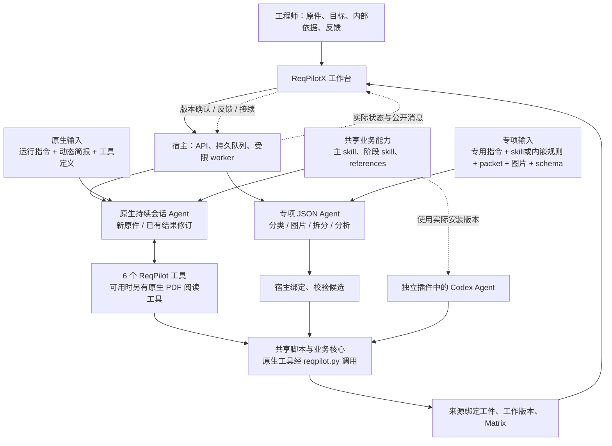
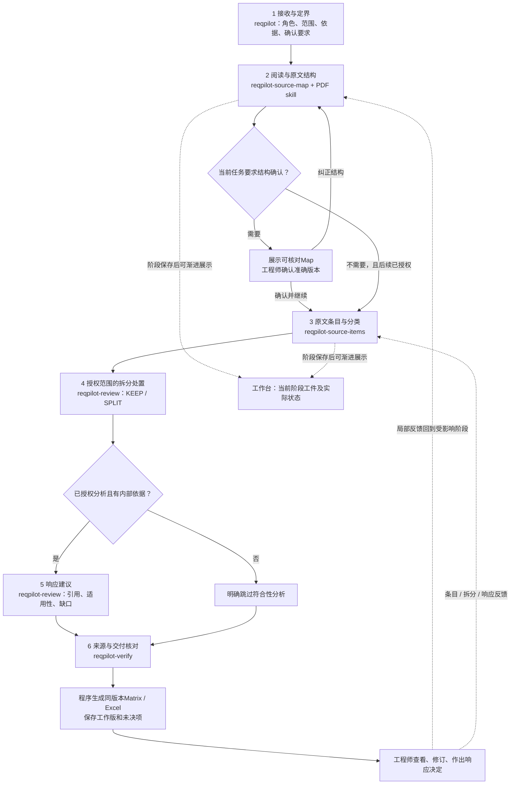

# ReqPilotX 工作流与Agent能力架构图

核对日期：2026-09-11。依据当前代码与技能源，说明原生主链、仍可调用的专项入口、插件和评测的关系。本轮仅制作架构说明，没有修改执行代码或启动模型。新任务简报的接线验证与行为验证边界见[任务简报](Agent任务简报与阶段交接.md)。

## 1. 实际运行架构

原生主链通常由一个持续会话Agent在不同阶段切换职责。五个业务skill不是五个固定Agent；worker是领取任务和驱动运行的程序。专项任务和独立核验也不能当成主链默认生成的子Agent。

图中两条应用模型路径都使用Codex App Server，但能力不同：

| 路径 | 实际入口 | Agent环境与当前提示来源 |
|---|---|---|
| 原生新原件 | `agent.source-item.extract-loop` → [source_document_loop_jobs.py](../../prototype/app/application/agent_workflow/source_document_loop_jobs.py) | [NativeLoopDriver](../../prototype/app/adapters/agents/codex_app_server/native_loop_driver.py)，持续任务/会话、动态工具；已接新任务简报 |
| 原生已有结果修订 | `agent.source-item.loop` → [source_item_loop_jobs.py](../../prototype/app/application/agent_workflow/source_item_loop_jobs.py) | 同一类NativeLoopDriver，原件/当前review/反馈与实际简报 |
| 专项按钮任务 | 分类、图片、拆分、分析各自job handler | [JsonStageDriver](../../prototype/app/adapters/agents/codex_app_server/json_stage_driver.py)，宿主提供固定packet/图片，指令明确不得调用工具或读取环境文件；未接新原生简报 |
| 独立插件 | Codex宿主 + 已安装/bootstrapped工作区 | 主skill和阶段skill，直接运行`reqpilot.py`；不自动获得应用的task_brief、数据库、已打开前端或全局项目历史 |
| 独立核验Agent | 仅实际安排时运行 | `reqpilot-verify`及冷核验协议；默认自查不构成独立模型核验 |

受限worker入口为[agent_workflow.py serve](../../prototype/scripts/agent_workflow.py)，按`source-item-workbench-v1`领取匹配任务。路由见[source_item_delivery.py](../../prototype/app/api/routers/source_item_delivery.py)、[agent_workflow.py](../../prototype/app/api/routers/agent_workflow.py)，job映射见[handlers.py](../../prototype/app/worker/handlers.py)。

## 2. 原生Agent承担的业务流程

以下箭头表示成果与协作顺序。局部任务只覆盖授权部分；Agent可回查、补读或修正前序判断，不必按固定页数或工具序列阅读。

这不是六个模型调用。第4步可以KEEP或不在本轮范围，第5步可以SKIPPED，第6步的Excel由程序执行。`reqpilot-verify`既可用于当前Agent自查，也可供另行安排的独立核验者使用；必须报告实际是哪一种。

一个容易被遗漏的Prompt入口是[confirm_source_document_map](../../prototype/app/application/agent_workflow/source_document_loop_jobs.py)：当前“确认并继续”动作绑定Map SHA后，实际会加入“完整条目、分类、必要拆分、按内部依据分支并导出”的续跑目标。它不是单纯写一个确认布尔值。这段宿主生成目标同样应纳入提示一致性与授权范围核对。

## 3. Prompt到底在哪里

| 层次 | 具体内容与用途 | 文件 / 注入位置 |
|---|---|---|
| P1 原生运行指令 | 执行授权目标、自由调查、保持来源/身份/人工意见；说明实际工具、工作目录与PDF环境 | [native_loop_driver.py](../../prototype/app/adapters/agents/codex_app_server/native_loop_driver.py)中的`developerInstructions` |
| P2 稳定业务委托 | 汽车SOR业务、Agent/程序/工程师分工、六步成果、反馈规则 | [reqpilot/SKILL.md](../../plugins/reqpilot/skills/reqpilot/SKILL.md)，原生`turn/start`显式提供；PDF可用时另显式挂载官方PDF skill |
| P3 本轮动态简报 | 完整用户请求、来源、当前工件、确认、依据、焦点、工作台路由、运行上限 | [native_task_brief.py](../../prototype/app/application/agent_workflow/native_task_brief.py)；两个worker调用，`reqpilot_context.task_brief`可更新；实际goal保存在`task-briefs/<hash>.json` |
| P4 阶段方法 | 结构、条目、拆分/分析、核验的语义方法及案例 | `reqpilot_skill`按需读取阶段SKILL.md和references；不是每阶段宿主自动换一个Agent |
| P5 工具提示 | 参数schema、作用、可用operation、下一步读取参数、编译错误和回执 | [native_loop_tools.py](../../prototype/app/application/agent_workflow/native_loop_tools.py)的`specs()`、context及程序返回值 |
| P6 补充/续跑输入 | 当前用户反馈、继续请求、结构确认后的宿主目标、版本绑定反馈 | 两个loop jobs中的steer/resume，原生review反馈及Map确认入口 |

上述内容共同构成执行上下文，不是某个孤立的“万能prompt.txt”。`skills/*/agents/openai.yaml`目前只有显示名称和简述，**没有额外的角色default_prompt，也不会创建一个子Agent**。

开发上下文skill位于`<private-local-path>`；项目内[reqpilotx-extraction-loop](../../.agents/skills/reqpilotx-extraction-loop/SKILL.md)用于主工作台提取/反馈实作。这些开发上下文、项目AGENTS和当前长会话不会自动注入隔离的原生执行Agent。生产需要的方法必须实际进入它所挂载的技能包或宿主简报。

## 4. 六个原生工具与脚本的关系

| Agent看到的工具 | 做什么 | 真正执行者 |
|---|---|---|
| `reqpilot_context` | 当前状态、来源/版本、路径、可用命令导航 | NativeLoopToolHost；原文任务由SourceDocumentToolHost补充 |
| `reqpilot_skill` | 列出/读取实际技能与参考文件 | 已冻结技能包；官方PDF能力存在时可读 |
| `reqpilot_read` | 读文本/JSON/目录/逐页MD，或读原PDF的页图/局部高清图 | 宿主读取与现有PDF renderer；没有独立的`reqpilot_render`工具 |
| `reqpilot_candidate` | 写入新的候选JSON | 宿主候选写入；保存候选不等于已编译成果 |
| `reqpilot_run` | 调用capture/compile/review/deliver等operation | [reqpilot.py](../../plugins/reqpilot/scripts/reqpilot.py)路由到共享脚本和业务核心 |
| `reqpilot_publish` | 请求应用保存检查后的review版本 | 宿主在该Agent回合结束后验证并保存；不代表工程师接受 |

原生PDF配置另提供只读shell、Python、Poppler与`view_image`，由[native_loop_pdf.py](../../prototype/app/adapters/agents/codex_app_server/native_loop_pdf.py)配置。它们用于调查；落地工件经宿主工具保存。逐页MD、页图、完整表格与来源索引可以复用，capture候选不限制Agent观察范围。

Map/Items的渐进展示来自编译后[阶段保存](../../prototype/app/application/agent_workflow/source_document_stages.py)，无需等最终`reqpilot_publish`；公开动作和消息由宿主事件投影到工作台。最终review保存与阶段成果不是同一个时点。

## 5. 各阶段的skill、任务内容、工具、脚本与参考

下表脚本相对`plugins/reqpilot/scripts/`；业务模块相对`prototype/app/application/agent_workflow/`。这些脚本执行确定性动作，不暗藏第二个语义Agent。

| 阶段 / 职责 | 使用skill与本轮任务内容 | 主要operation → 脚本 / 业务实现 | 应读参考 |
|---|---|---|---|
| 接收与定界 | `reqpilot`：明确原件身份、业务范围、资料与确认要求 | 原生`reqpilot_context`；独立CLI的`doctor / catalog / workbench` → `reqpilot.py` | 主SKILL；`reading-guide.md`、`tools-host.md`；进入账本前读`business-contract.md` |
| 阅读与Map | `reqpilot-source-map`；PDF时官方PDF skill：恢复真实章节、编号正文、表图归属、祖先及边界 | `capture` → `prototype/scripts/fast_source_capture.py`；`reading-workspace` → `reading_workspace_tools.py`；`inspect-source` → `source_authoring_tools.py`；`compile-map` → `artifact_tools.py + map_edit_tools.py + map_review_tools.py`；实际文字缺口时`capture-pdf-text` → `pdf_text_tools.py` | `tools-capture.md`、`tools-map-edit.md`；疑难查`source-reading.md`、`tables-and-relations.md`；低层语法`tools-map.md` |
| 条目与分类 | `reqpilot-source-items`：完整原文、需求/非需求判断、分类、原序、表图与共同条件 | `compile-items` → `artifact_tools.py + source_requirement_baseline.py`；`image-packet / compile-images / compile-annotations` → `artifact_tools.py + source_item_visual.py`；原文图与Agent释读分开 | `tools-items.md`、`tools-images.md`、`judgment-cases.md`、`tables-and-relations.md`；封面/目录查`tools-front-matter.md` |
| 授权拆分 | `reqpilot-review`：完整父项KEEP/SPLIT，保留逻辑、条件、例外和可追溯子项 | `decomposition-packet / compile-decomposition` → `artifact_tools.py + source_item_decomposition.py`；程序分配Snn和校验绑定 | `tools-decomposition.md`、`judgment-cases.md`中的J07–J08、`business-contract.md` |
| 有据分析 | `reqpilot-review`：比较适用内部依据，给出带引用的响应建议和缺口 | `analysis-packet / compile-assessments` → `artifact_tools.py + evidence_tools.py + source_item_analysis.py`；资料注册由应用/获授权CLI的`register-evidence`完成，该注册命令不在原生6工具的operation白名单内 | `tools-analysis-delivery.md`、J09、`business-contract.md`；无资料遵守SKIPPED策略 |
| 核验与交付 | `reqpilot-verify`：核对原件语义、版本、关系、有效意见及导出一致性 | `review-verify / review-close` → `revision_tools.py`；`deliver` → `artifact_tools.py + source_item_delivery.py + services/exporter.py`；应用请求`reqpilot_publish` | `semantic-self-check.md`、J10、`tools-analysis-delivery.md`、`manual-decisions.md` |
| 反馈修订 | 主skill加受影响阶段skill：局部修订，保留无关内容、稳定ID和有效人工意见 | `review-open / review-feedback / review-packet / review-revise` → `revision_tools.py`；范围修订复用`scope_tools.py`，Map转换复用`map_tools.py` | `revision-loop.md`；回到被影响阶段的语义案例 |
| 独立核验，可选 | `reqpilot-verify`：原件、指定候选、业务合同和范围；独立产出定位明确的发现 | 实际启动的新Agent/会话使用可用读取工具和`review-verify`；没有默认自动启动脚本 | `multi-agent.md`；不给生产者推理、历史答案或期望数量 |

## 6. Reference实际有哪些

根目录为[plugins/reqpilot/skills/reqpilot/references](../../plugins/reqpilot/skills/reqpilot/references)。

| 文件 | 覆盖内容 |
|---|---|
| [reading-guide.md](../../plugins/reqpilot/skills/reqpilot/references/reading-guide.md) | 正常路线、N01–N08普通场景、按疑问选择参考、阅读与恢复事实 |
| [source-reading.md](../../plugins/reqpilot/skills/reqpilot/references/source-reading.md) | R01–R09：封面目录、标题续文/附件、原生PDF、扫描/OCR、坏字符、噪声、双语多版本、工程图、外部引用/Office |
| [tables-and-relations.md](../../plugins/reqpilot/skills/reqpilot/references/tables-and-relations.md) | T01–T12：参数表、BOM、完整试验、协议矩阵、计划表、合并值、表注、续表、全页框表、表内图、选择/空值、长表批次 |
| [judgment-cases.md](../../plugins/reqpilot/skills/reqpilot/references/judgment-cases.md) | J01–J10：五类要求、规范性、完整目标与拆分、选项/TBD/冲突、内部证据、修订与导出归因 |
| [worked-examples.md](../../plugins/reqpilot/skills/reqpilot/references/worked-examples.md) | 一个可运行的完整合成例：两页PDF、封面目录、两条要求、整份BOM，经Map/Items到Matrix/Excel；命令`worked-example`执行[worked_example.py](../../plugins/reqpilot/scripts/worked_example.py) |
| [semantic-self-check.md](../../plugins/reqpilot/skills/reqpilot/references/semantic-self-check.md) | 来源、结构、条目、判断、交付五组自查与发现格式 |
| [business-contract.md](../../plugins/reqpilot/skills/reqpilot/references/business-contract.md) | 身份、业务对象、分类/派生及证据权威的共同合同 |
| [revision-loop.md](../../plugins/reqpilot/skills/reqpilot/references/revision-loop.md) / [manual-decisions.md](../../plugins/reqpilot/skills/reqpilot/references/manual-decisions.md) / [multi-agent.md](../../plugins/reqpilot/skills/reqpilot/references/multi-agent.md) | 版本修订、实际人工决定与获授权委派/冷核验 |
| `tools-*.md`与[tools.md](../../plugins/reqpilot/skills/reqpilot/references/tools.md) | capture、map、map-edit、items、images、decomposition、analysis-delivery、Office、front-matter、host的具体语法 |

普通/特殊语义短案例有多组；可贯通运行的完整教学例目前集中在一个合成例。真实客户历史工件保留在私有runtime-data，不直接塞进生产skill。这是当前覆盖状况，不代表所有案例都已由Sol/Luna独立验证。

## 7. 专项入口：目前没有全部收敛到上面的提示栈

这些是真实应用入口，不能因原生主链已存在就从图中省略。统一JSON执行器明确要求仅使用packet、不得调用工具；它们因此更依赖宿主是否提供完整上下文。

| 专项任务 | 实际skill/prompt | packet、脚本与参考 |
|---|---|---|
| 分类重核 | `reqpilotx-contextual-classification-review`；加载`reqpilotx-parent-provision-recognition`的技能闭包，再追加当前分类V1 | [source_item_classification_jobs.py](../../prototype/app/application/agent_workflow/source_item_classification_jobs.py)；agent-kit的parent-provision references、当前分类文档、绑定原文和页图 |
| 图片条目 | 内嵌`IMAGE_SKILL` + 本轮`task_directive` | [source_item_image_jobs.py](../../prototype/app/application/agent_workflow/source_item_image_jobs.py)；节点图锚、原页、祖先上下文和输出schema；没有自动读新版`reqpilot-source-items` |
| 指定原文拆分 | `agent-kit/.agents/skills/reqpilotx-requirement-decomposition/SKILL.md` + 锁定references + 当前分类V1 + 拆分directive | [source_item_agent_jobs.py](../../prototype/app/application/agent_workflow/source_item_agent_jobs.py)；原文/共同条件packet、原页、quote绑定与共享编译器。manifest里的旧D4端点PLANNED不等于这个SourceItem拆分入口不存在 |
| 指定单元分析 | 内嵌`ANALYSIS_SKILL` + 证据分析directive | [source_item_analysis.py](../../prototype/app/application/agent_workflow/source_item_analysis.py)、[source_item_agent_jobs.py](../../prototype/app/application/agent_workflow/source_item_agent_jobs.py)；冻结分析单元、内部事实catalog、图片和schema |

本次确认的剩余问题：新业务主skill和动态task_brief只接了两个NativeLoop入口；专项入口仍有独立指令/旧kit/内嵌skill。这是提示与工具可达性的一致性缺口，尚未证明造成了哪一次具体业务错误。本轮记录，不据架构图直接改运行权限或替换专项执行器。

## 8. 插件、开发经验和评测的位置

独立插件由[build_bundle.py](../../plugins/reqpilot/scripts/build_bundle.py)复制允许的共享业务核心与skill。`bootstrap`生成[AGENTS.template.md](../../plugins/reqpilot/AGENTS.template.md)和技能发现入口；`workbench`可以发现/打开已运行的本机应用，但不安装一套前端，也不把独立CLI成果自动导入某项目。个人已安装版本和旧任务冻结包均不会随源码修改自动升级。

开发中的“问题 → 原件重验 → 方法/脚本 → skill/reference → 运行接线 → 冷启动验证”不等于执行Agent每次要读完整开发历史。当前可复用经验应进入上表中的实际文件；[开发计划](开发计划.md)和历史记录只用于研发接续。

原生Map评测入口[evaluate_native_map.py](../../prototype/scripts/evaluate_native_map.py)共用NativeLoopDriver、ToolHost和任务简报，冻结来源、包、宿主、目标与独立rubric，记录首件、耗时、用量和结果。它不经过HTTP/队列/数据库/UI；需要另外进行应用链路验证。独立插件的[cold_run.py](../../plugins/reqpilot/scripts/cold_run.py)从新工作区及`request.md`启动Codex，技能发现隔离与独立语义成功分别记录。

后续模型配置按用户指令为Sol high、Luna max；它们是相同角色/入口的评测配置，不是给每个阶段固定分配不同模型。本轮无新模型调用，也没有把新版提示标记为行为验证通过。
