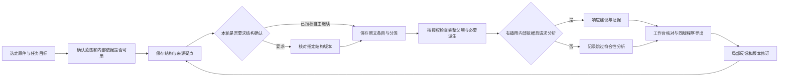
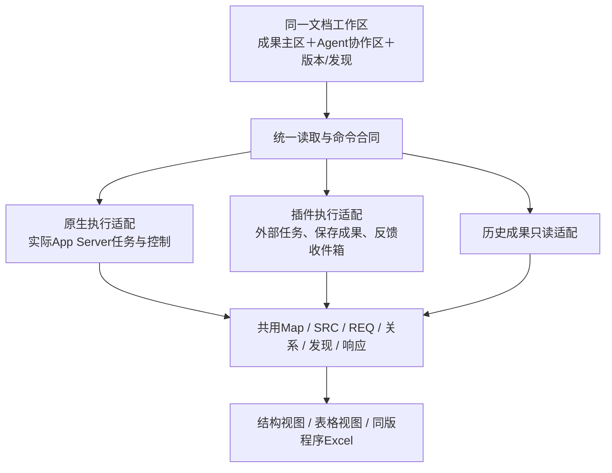

# 统一工作流与工作台专项

更新：2026-09-12。状态：**P0已完成；用户授权后的P1/P2首批切片已实施并完成相关回查，P3/P4未完成。** 用户要求将项目工作流、UI、插件和原生Agent应用的适配、旧功能整理作为一个专项推进。本文收敛此前[Agent原生工作台方案](Agent原生工作台整体评估与方案.md)与[插件接入](Plugin工作台接入与反馈闭环.md)，不再新增第三套界面方案。实施顺序仍由[开发计划](开发计划.md)统一维护。

## 目标与责任

工程师只需理解“当前文档、正在核对的版本、工作进展、已有成果、发现的问题、需要我做什么”。插件、App Server及历史导入是成果生产和执行方式，不应决定用户看到另一套产品。

- 本任务“PDS 逐条对齐最新拆分与判定反馈”（`01a07a68-81d1-7561-9f46-7308bf3e9330`）负责业务工作流、原文/编号/发现/范围/版本等共用合同、提取工具和skill、插件/原生执行适配及业务验收。
- “升级工作台 UI 为 Agent Native”（`01a08a20-5de4-7860-8afc-ef0cade419bb`）负责UI信息架构、导航/主区/协作区、视图与密度、组件整理和真实交互验收。已完成[UI协作评审](统一工作流与工作台专项-UI协作意见.md)，共同确认原条号投影、直属/子树计数、插件绕过协作区和导出路由断点；P2最小字段、动作及回执语义已合并到下文。本稿保持唯一专项主方案，不另立实施顺序。
- 共用的API类型与读写接口先对齐再分别改；同一轮不同时写`NativeStructureReferenceDock`、`SourceRequirementNodeLens`、`DocumentWorkSurface`等共享前端文件。UI会话提出消费合同，本任务负责服务端/工具实现；每个增量都一起验收。
- 后续用户已授权下一步实施；本任务负责P1/P2业务与执行适配，UI任务负责前端。具体进展见[业务实施](统一工作流与工作台专项-业务实施记录.md)。用户新增的文件夹建议已由独立Sol high初评、再由用户指定的[Astra ultra复评](文档任务文件夹与工件约定-Astra复评.md)更新。当前直接交付实体任务工作区与程序接续能力，复用已有持久化；通用DB/family/unit实体不作前置。

## 问题基线、纠正与责任

| 编号 | 现象 | 实际原因与边界 | 责任/处理 |
|---|---|---|---|
| W01 | 2.6后到2.10，没有发现提醒 | 主skill强调保留跳号/重号；`audit-map`检查覆盖、顺序回跳、块内编号与跨页父级，但未形成通用编号间断发现。表格虽有`source_numbering_anomaly`，它不是覆盖所有条款的发现闭环 | 本任务：原编号观察、回源核查与发现工件；UI会话：显示/定位/处置 |
| W02 | Product requirements旁边“1 条”含义不清 | `SourceItemLedgerBranch`直接显示`direct_source_item_count`；此字段仅统计该节点直接拥有的SRC，非子树需求总数。当前样例直属1项是2.1～2.4的Operating conditions；本章已保存结果共8个SRC、8个判为需求的父项，另有2个Snn | 共用统计合同＋明确范围文案；不靠展开状态、可见行数或标题词猜分母 |
| W03 | 表格审阅没有明确原文编号 | `SourceLedgerTable`编号列使用REQ/SRC；原条号仅可能混在标题里。Matrix已有`source_number`及多原条号证据，而当前outline/reader未完整传递。不是刻意隐藏编号的合理产品选择 | 本任务贯通共用原条号投影；UI会话显示原条号与系统身份，不能各自正则推号 |
| W04 | 两种视图用途/使用顺序不清 | 当前仅放切换按钮，未把结构初审、逐项评审、回源定位与阶段状态明确关联 | 同一账本的两个观察方式；定义如下 |
| W05 | 插件草稿没有Agent协作 | `DocumentWorkSurface`按`pluginSessionId`返回独立包装；既有`DocumentAgentContext`没有接入。`sourceReader`关闭native调度以避免误启动，但没有提供插件协作替代能力 | 恢复统一协作区；执行能力由adapter声明，不能用移除整个区域处理差异 |
| W06 | 不同入口切换到不同页面，重复嵌套 | `reviewCase`、`requirementSetId`、native工作版、插件版本、MAP/ITEMS阶段预览各有路径；`SourceItemWorkspace`在404时还可回退旧Matrix/导出入口；UI会话也核实`task=export`仍可落到插件提取主体。局部组件复用没有统一导航与状态归属 | UI会话清查入口；本任务补显式版本选择与能力合同；逐条迁移而非一刀删除 |
| W07 | 页面计数/待处理/草稿标签可能相互冲突 | UI评审实见整体显示“符合性分析未执行”，行仍称“尚未分析”；状态散在任务、工件、工作基线、插件head、工程师响应和旧Set；“草稿”“处理中”“本轮完成”“已接受”不能互相替代 | 分开任务状态、成果完整度、审阅/发布状态与来源；统一读投影 |
| W08 | 完整流程与旧专项仍缺收口 | 已记录KEEP/UNDO理由、授权范围剩余项、分析/人工依据传输及机械输入问题；这些不能被UI工作覆盖或被测试数量掩盖 | 纳入同一专项的业务依赖和退出标准，保留Sol high/Luna max复测 |
| W09（撤回） | 上轮声称编号索引会误报 | 复查已安装源码并直接运行其review-verify，确认是`dict.get(key, default)`，不是元组键；旧“13项误报”来自主Agent错误模拟，不是产品缺陷 | 撤回错误结论与复现，保留纠错记录；不为不存在的问题改索引 |

以上W01～W08记录P0调查时的断点，W09为其后复查撤回的错误判断。用户授权后，原编号投影、数字正文编号候选、章计数、KEEP理由/范围和统一协作/交付首切片已实现并回查；具体最新状态以[业务实施](统一工作流与工作台专项-业务实施记录.md)与[UI实施](统一工作流与工作台专项-UI实施记录.md)为准。通用发现处置、全量旧入口迁移及新原件模型验收未完成；样例统计不等于源语义重新接受。

## 用户工作流与两种视图

“返回结构”表示按受影响范围回查，可以只修条目/分类/释读/派生/响应，不意味着全文重跑。每个阶段可以保存部分有效成果并显示剩余范围。没有内部依据仍检查原文编号、矛盾、缺附件、含糊判据与授权拆分；无需等待符合性分析才能发现这些问题。

| 视图 | 主要问题 | 默认使用时机 | 同一对象必须带什么 |
|---|---|---|---|
| 结构与原文 | 原件怎样组织，有没有漏段/错位/错归属；表格与图片及跨页关系是否正确 | 首轮结构核对；条目审阅遇到来源疑点时回到具体范围 | 完整路径、直属内容、真实条号、原表/原图及精确定位；目录/封面整体可读但不乱发SRC |
| 表格审阅 | 全部原文条目是否覆盖，分类/派生/响应如何，哪些需要集中处理 | 结构可用后逐项/跨项评审；响应和差异核对 | 原条号、完整来源身份、SRC/REQ、分类、派生来源、响应/发现状态和范围明确的计数；单击即看相同的完整详情 |

推荐“结构初审→条目表格逐项审阅→发现问题时局部回源”，允许随时切换。两种视图不是两条提取流程，也不是不同数据版本；保留选中对象、焦点、筛选、正在看的版本和未提交意见。表格审阅是工作清单，不是把原件中的所有表格变成另一张扁平表。原表、BOM整体、父条款和派生关系都保留。

编号明确分列/分标签：客户原编号（如2.6）；来源身份（SRC-xxxx）；需求身份（REQ-xxxx/REQ-xxxx-Snn）。原件无编号就显示“无原编号”，不拿系统号顶替；整份BOM可以显示“原条号1、2、3”并展开证据。派生Snn继承实际来源编号或来源范围，不伪造2.5.1之类客户没写的条号。

章节主统计建议为“本章原文8 · 需求8”，按完整子树的唯一SRC计数；直属“1项”只在详情/提示里说明。筛选、派生、实际分析单元和待处理数单列：当前样例2.5有两个派生，分析分母是8−1＋2＝9，不能把父项与替代它的两个分析子项全算进去。若只处理了部分范围，必须同时显示覆盖范围/未知剩余，不能把已生成数量称为整章应有总量。

## 编号发现：保留原文与主动提醒同时成立

第一步从可追溯的真实正文编号、同级关系及阅读顺序产生候选，再回查原页/逐页材料。输出示例：

> 第2章原文在2.6后直接出现2.10，未见2.7～2.9。已保留原编号；请核对是否为原件有意省略或缺页/缺段。定位：两端原页及条款。

没有完成相关原页核查时，只能写“当前成果出现编号间断，待回查原件”，不能先认定客户漏号或Agent漏提取。

| 场景 | 应怎样处理 |
|---|---|
| 同一编号序列2.6→2.10，原页也如此 | 提醒原件编号间断；不补内容、不重排、不自动发SRC/REQ |
| 原页有2.7～2.9，工件没有 | 提取遗漏，回到捕获/结构/条目中最早出错层修复，再验证显示与导出 |
| 2.6→3.1，或附件重新从1开始 | 已有层级/独立文档重置依据时不是缺号；不把两组编号混比 |
| 目录、省略引用或“见2.10” | 非正文同级序列，不作为正文跳号输入 |
| 完整BOM或试验内部编号 | 保持整体，仍可报告内部编号异常，不因此拆成多个REQ |
| 图号/表号、OCR低置信号、跨页重复表头 | 使用各自序列和证据；不混入章节号；无法确定时保留待回源状态 |

发现与原文对象分开保存：`finding_id`、类型、来源/成果版本、涉及节点/SRC、两端原编号和定位、检查范围、观察、是否已核查原件、建议动作、处置状态及依据。来源发现、提取错误、表示错误分别归因；Agent完成修订不等于工程师接受。重新核验确认来源未变可沿用处置，来源/范围变了则显式待重核。

一般编号间断是提醒，不阻止有效成果保存、条目继续整理或草稿导出。导出/交接说明携带当前未决发现；不能把发现当成新增需求行。先提供最小共用发现工件，再接skill自查、CLI报告、工作台发现入口及导出交接，避免四套独立检测。

## 一个工作区，两种执行适配

### 最小合同

| 合同 | 必须表达的内容 |
|---|---|
| 工作上下文 | project/document/source digest、当前成果引用、选中对象及范围；生产者、实际存储版本、Map/baseline/响应版本各保留，不假装所有revision是同一种编号 |
| 文档任务视图 | 真实目标、任务/运行身份（可为空）、状态及最近更新、已有成果、未处理范围、待决定问题；已结束或外部状态未知时没有假运行动画 |
| 成果视图 | 有序账本、原编号/编号集合及依据、完整内容/关系、原图/释读、分类、派生、有效响应、发现、覆盖和审阅状态 |
| 范围统计 | 直属/子树SRC、需求/非需求、派生、实际分析单元、匹配、未处理/未知；说明作用域和是否受筛选影响，去除1:1共行导致的重复计数 |
| 能力与动作 | 每个动作返回可用性、原因、真实执行目标及来源/版本前置；command_id、幂等回执、冲突和结果版本。UI不依靠`pluginSessionId`等URL字段推断整页能力 |
| 发现与意见 | 同一范围标识，区分来源发现、用户要求修订、工程师响应意见、结构确认和成果接受；不能混成一类聊天消息 |
| 版本与导出 | 同版树/表/详情/Excel；明确全量/筛选范围；刷新不换版本，未提交意见不改对象。历史只读不能因原生工作版缺失而悄悄替换来源 |

协作区始终有同一个入口，折叠是用户视图状态。插件暂不能自动唤醒已结束会话时，仍能展示目标、成果、真实记录、保存意见和“待外部任务取回”的状态；可识别原会话且宿主支持跳转时提供继续入口。暂不支持原生的暂停/恢复/直接工程师意见时，清楚表达该动作不可用及下一步，而非隐藏整个协作区。native也按真实能力显示，不从插件的限制反向删掉既有原生能力。

不能为统一页面额外启动一个模型、把外部反馈投到无关native任务，或伪造同一连续执行历史。读取动作流、公开消息流、成果流仍按各自真实记录汇合。

### P2接口交接与统一行为（已合并UI意见）

具体消费字段/动作表保留在[UI意见第4节](统一工作流与工作台专项-UI协作意见.md#4-p2-最小服务端字段与动作名单)。双方采用以下语义，字段最终类型由共用实现落定：

1. **工作和查看绑定**：真实`work_ref/result_ref/producer_ref`，可空`task_ref`，`viewed_revision_ref`与`latest_revision_ref`分开。先恢复用户明确选择；多个来源无选择记录时明确展示可选成果。native v14、plugin v3和旧Set不能按数字或更新时间比较后静默互换。
2. **任务报告与同步**：传回真实`goal|null`（当前plugin head已有goal而_public漏传），区分`last_reported_at`与`last_synced_at`。缺外部运行报告为UNKNOWN/UNREPORTED，不推断在线、结束或运行中；没有目标不伪造委托。区分策略跳过、待处理和能力不支持。
3. **能力矩阵**：每项含`action_id/supported/enabled/reason/target_scope_kinds/execution_target/effect`；URL与reader是否存在不决定权限。固定协作指固定入口和上下文，宽屏停靠/窄屏切换/用户折叠由UI负责，不要求永久占列宽。
4. **真实协作回执**：记录稳定ID、producer/task、时间、版本和游标。反馈已保存、已送达或取回、报告修订、人工核对分开；没有取回凭据时不显示已消费。插件可先投影已保存的版本、确认和反馈，不要求先重做事件流。
5. **最小动作**：读取版本/阶段/详情/活动，保存范围反馈，确认指定Map，已有native运行补充/暂停/继续，显式空文档启动，同版程序导出，以及有真实宿主能力时打开原任务、否则复制接续说明。打开外部任务不等于恢复模型执行。
6. **命令幂等和冲突**：写动作带`command_id`、完整工作/producer/原件/查看版/对象范围；返回保存回执、实际effect、状态和结果版本。复用后端幂等存储，前端保留未决命令ID重试，不每次换UUID。P2保留当前plugin只允许向head写入的边界：历史版草稿保留，409明确显示，不自动改绑。
7. **发现检查状态**：补`scan_state/checked_scope/complete_or_unknown`；未检查或未接服务不以空数组显示“没有问题”。一般编号发现不阻止已有成果可读/可导出，但检查范围必须可见。
8. **页面目的与版本导出**：analysis/export保持同一工作区并显示相应内容，能力不支持时解释该项限制，不能回到提取主体。默认导出所看版本的全部已保存范围；筛选导出需明确选择，折叠不截断导出。

UI提出“条目台账/原页对照”作为名称建议，保留本稿定义的两个视图职责；命名在UI实施时统一，不再额外增加一层同义阶段条。列设计确保原编号始终可见，窄栏可以放在内容行首，不能为密度隐藏。

外部自动唤醒、完整人工/内部证据传输、plugin FORMAL及逐条历史diff不阻塞P2。既有native人工意见、历史及交付能力按各自真实就绪状态保留；不能由“已有版本”泛称所有来源均有正式接受/锁定能力。P2不要求新建第二套业务数据库、幂等系统或额外模型。

## 旧入口与功能的整理清单

“旧”不等于“可以删除”。先查是否仍承载客户版本/人工决定或不可替代能力，补读适配及回归，再退出日常入口。

| 当前实现/路径 | 本专项处理 | 保留条件 |
|---|---|---|
| `DocumentWorkSurface`＋`DocumentAgentContext` | 作为统一外壳演进；固定成果与协作关系 | 新文档、工作版、阶段、插件、历史都能进入相同外壳 |
| `PluginWorkbench`＋`SourceWorkbenchReader` | 保留传输/数据适配，取消独立外壳与任务分支 | 不可变版本、反馈、来源验证、幂等、导出继续有效 |
| `NativeStructureReferenceDock`＋`SourceItemLens`＋`SourceLedgerTable` | 保留成熟读内容/定位能力；按职责拆出纯显示与controller | 原序、表格、图像、上下文、键盘、宽度、旧意见不退化；不继续将所有provider逻辑塞进大组件 |
| `SourceDocumentStageResults` | 阶段数据变为统一成果视图的来源；减少单独预览套一层页面 | 仅Map/部分Items也可读、可保存、有确认入口，不要求先有完整baseline |
| `SourceDocumentActions`、局部`SourceItemAgentLoop`、`AgentWorkflowCockpit`、旧运行轨迹 | 控制/状态归入统一协作controller，生成记录按来源挂成果；日常页减少重复入口 | 底层队列、历史事件、错误诊断和已验证运行能力继续保留 |
| `SourceItemWorkspace`在404时回退旧Matrix/Exports | 改成显式“尚无成果/当前来源异常/选择历史版本”；不按请求失败选择另一套业务流程 | 真正旧成果仍可按其版本显式打开，异常不伪装无结果 |
| `RequirementMatrixWorkbench`＋`requirementSetId`旧锁定Set | 保留历史成果/决策/交付能力，逐步由历史adapter接入统一工作区；从普通工作流退出重复入口 | 旧ID和链接可解释跳转，原分类/人工决定/锁定与导出不丢；不重新编制客户成果 |
| `CandidateReviewWorkspace`＋`reviewCase` | 归入开发/评测能力；已有案例数据保留，日常用户不从隐式路由进入专用候选壳 | 冷审/评测可继续，但不能冒充生产工作区验收 |
| `ReadingWorkspacePage`、`/pdf-viewer` | 保留阅读与证据定位用途，通过同一文档上下文进入 | 原件阅读工具不是第二套需求业务账本；不因它独立就判过时 |
| `target_review`/`type_review`及旧端口页面 | 核实能力后归档为内部案例/诊断入口；取消当前主skill的正常交付指向 | 先保留历史工件和必要回查能力，不删除客户数据，不仅因legacy字样删代码 |
| `ExportsPanel`、WorkingExport、插件直接下载 | 统一交付摘要与能力入口，底层同版程序导出继续复用 | 工作草稿、锁定历史、带人工意见的交付不混称正式版本 |

## 目录方案的Astra复评决定

[复评](文档任务文件夹与工件约定-Astra复评.md)已完成，并逐字保留Sol原文为历史。当前采用“实体项目/文档/持续任务工作区＋程序工件字典/索引＋现有owner适配”。本任务此前“不先迁DB”正确，但仅列类型字典与索引不足以满足用户目标；下一步必须实际交付初始化、自动选址、动态任务简报、前端绑定和恢复。

复评时隔离真实函数/harness已证明custom binding/cwd与阶段配套缺口，没有证明最终Excel混版。后续[任务工作区首增量](任务工作区与接续工具.md)已修复并实现实体任务根、公共workspace命令、最后提交回执、候选/历史和现有owner适配，完成两文档＋同原件第二任务的真实CLI/HTTP/Excel验证。新sessions API已生效，UI尚未消费；不借该增量扩大为数据库重建。

UI专门任务后续已完成[断链与职责根因诊断](工作台断链与职责重叠根因分析.md)，并继续修导航遮蔽、知识三态/关联路径语义、整理与响应职责。阅读发现、知识事实与当前工作上下文仍须打通；多任务列表不能代替这些交接。主任务负责共用业务/工具与模型验证，UI实现仍归该任务。

## 实施顺序与可以验收的增量

| 增量 | 工作与责任 | 可以验收的结果 |
|---|---|---|
| P0 已完成 | 本任务记录事实/业务合同/专项；UI会话已独立评审，最小接口语义和文件责任已对齐 | 一份主专项、唯一开发计划入口、UI协作意见和真实待做状态，不再分头换界面 |
| P1 业务读取与发现 | 本任务：核对实际一致性检查范围，原编号贯通、范围统计、编号候选/回源处置、KEEP/UNDO范围状态；UI会话可并行设计消费者与迁移清单 | 同一条目在树/表/导出有同一原条号；“本章8/直属1”可核算；跳号有带来源的提醒但不补号；部分完成不误报全范围完成 |
| P2 统一外壳首个纵向切片 | UI会话实现主区/协作区/视图；本任务实现native/plugin TaskView/命令适配，移除当前按producer替换外壳 | 同一PDF的Map→确认→Items→反馈→新版→Excel；插件和native各走实际执行器，协作不消失、不混版、不多开模型 |
| P3 入口迁移与完整能力 | UI会话收敛旧入口/历史/诊断/交付；本任务补响应/人工依据传输、旧成果只读适配和版本冲突语义；来源变更后的意见有效性按现有合同 | 日常导航不嵌套到另一套页面；旧链接/客户版本可回查；每项保留能力有迁移依据，缺能力诚实可见 |
| P4 评测与经验收敛 | 本任务主导Sol high/Luna max；UI会话验证真实交互及性能/可达性；补精炼skill与正反例 | 程序/源语义/模型/交互/恢复/导出分别有证据；新会话能按相同工作流行动，不只会复述skill |

P1与P2围绕同一最小案例交叠，先交付可核对切片；响应/Office等能力扩展不阻塞原文整理切片。本专项不是停掉plugin质量改进重做整个应用，更不是立即删除全部旧模块。

### 验收矩阵

1. **来源与编号**：2.6→2.10原件跳号、捕获漏2.7、章节重置、目录、重复号、跨页续表、整份BOM分别有正反例；无正当依据不补号、不改序、不新建需求。发现的检查范围和来源状态可回查。
2. **同账本两视图**：同一版本相同SRC顺序/父级/原条号/表图/分类/派生/响应；切换保持选中对象和意见草稿。表格筛选不截断完整原文详情。
3. **范围统计**：直属/子树/匹配、父项/派生/分析单元可复算；折叠与1:1共行不改变业务总数；无可靠范围时显示未知，不显示假0/假完成。
4. **两种执行方式**：分别在native和plugin验证空文档、仅Map、需确认、部分Items、完整工作版、失败但有成果、反馈已存未取回、已结束任务、断线及重连。UI操作不能跨producer误投；插件不为显示协作而产生第二个模型。
5. **版本与迁移**：旧深链接、多个生产者/多个任务、历史查看、返回、刷新、来源替换、旧意见、重复点击/重试、导出范围均有明确结果；旧数据不静默重签，应用404不隐式跳旧流程。
6. **原件与同版导出**：原文、原图/表、释读、明确关联条件、Snn与有效响应都存在；全量/筛选导出范围明确，普通Excel由内部程序执行。
7. **效率与可用性**：记录首个可核对成果、详情切换等待、一次反馈闭环操作数、状态同步/恢复、原页查找成功率；基线测量后才设阈值，不拿5页样例时延承诺449SRC长文档。
8. **模型评测**：仅Sol high与Luna max；冻结同一原件、任务、skill/工具版本和范围；材料齐备/原件冷启动分开。先把工具和界面干扰排除，再判断模型能力。评测中修工具的运行单列，保留集不提供答案；不需为UI布局测试重新跑模型。

每个增量分别记录“实现、程序验证、真实界面行为、来源语义、用户接受”。P0后的授权已推动P1/P2首批切片实施，见[业务记录](统一工作流与工作台专项-业务实施记录.md)与[UI记录](统一工作流与工作台专项-UI实施记录.md)；P3/P4、文件夹批量物化和通用发现处置没有因此完成。

本轮事实回执：私有`prototype/runtime-data/plugin-workbench-implementation-20260912/workflow-planning-evidence.json`保留同源v3统计及编号检查核实及W09撤回记录。9份直接关联的活文档链接已检查，`git diff --check`通过；没有为文档规划重跑业务测试。[UI详细评审](统一工作流与工作台专项-UI协作意见.md)已收到并合并；P0规划完成，不代表P1～P4实现完成。
