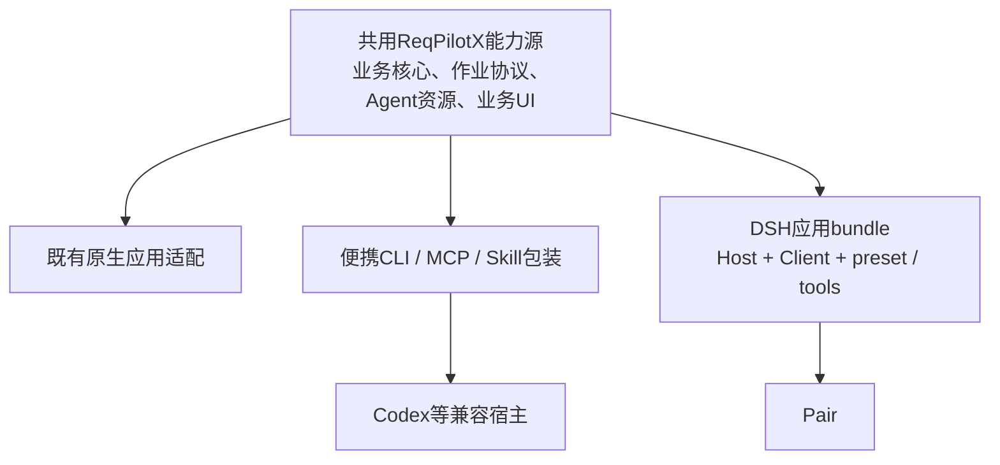

# 共用能力与DSH应用插件的同步约定

更新：2026-09-14。用户强调：Pair采用DSH官方支持的插件机制，并确保现有能力包、Agent原生设计和DSH应用插件持续一致。本文件定义目标边界与实施检查，不代表全部共源改造已完成。

## 三类设计各自是什么

- **可移植ReqPilot能力包**：业务skills/reference、读取与编制工具、任务协议及可携带运行模块的一种分发形态。
- **Agent原生设计**：角色/目标、阅读自由、工具分工、任务与成果状态、反馈修订和交付方式，是共同执行设计；它不应该成为第三套独立业务实现。
- **DSH应用插件**：把共同执行设计及业务UI/服务接入Pair的宿主包装，负责安装、服务注册、会话、视图与事件连接。

因此不是维护三套workflow再人工对齐，而是一份业务能力源，经多个宿主适配和构建出口发布。

## 官方插件机制与当前接入的区别

现有Pair源码中的`bundle/pair-web`使用npm包、`package.json`的`dsh.bundle.patch`和`cordis.patch.yml`组合Cordis插件；带前端的叶插件使用`dsh.client`声明与`./client`构建导出。安装走支持的`dsh plugin --profile web add <package>`，应用启动走dsh profile。

ReqPilotX完整应用将沿用这个机制，不把它说成DSH官方认证的产品。当前已有filesystem-skill能力包，以及常用Pair web的应用bundle、托管PG/API和原生项目/PDF入口；Agent任务绑定/执行及完整分发仍未完成。MCP是可选调用协议，不承担应用安装、UI或完整生命周期。

## 权威来源与边界

| 内容 | 唯一维护来源/目标 | 适配层可以做什么 |
|---|---|---|
| 原文模型、分类、来源与派生原则 | ReqPilotX产品定义、模型V1及相应共用实现/案例 | 不另定义Pair专属分类、BOM拆分或上下文语义 |
| 业务执行协议、角色与task brief、skills/reference | 共用Agent作业协议和同源Agent资源 | 包装宿主提示、填入实际环境和工具映射，不复制一份改写后的业务规则 |
| 工具参数、诊断与业务写入 | 共用任务请求模型、schema、编译/版本/导出服务 | CLI/MCP/DSH包装调用，进行可测试的协议转换；不在Node重做Python业务逻辑 |
| 工件种类、索引、身份和成果版本 | 共用业务工件与版本合同 | 与Pair workspace/session建立引用映射；聊天日志不替代业务数据 |
| 业务视图与状态模型 | 同源ReqPilotX工作台组件/控制器 | 注入导航、认证传输、主题、容器、文件与会话动作 |
| 模型请求、执行控制、宿主权限 | 对应宿主适配；Pair使用DSH服务 | 处理真实运行差异，不要求各宿主系统提示字节一致 |
| 包与平台兼容 | 每个适配包自己的manifest及兼容范围 | 各自声明依赖/平台版本，同时锁定所使用的共同能力版本 |

已有基础：`build_bundle.py`从ReqPilotX共用Python模块构建便携包，并记录文件/hash；`task_schema.py`从同一个REQUESTS请求模型生成字段与枚举说明。**这些证明部分代码与schema已经同源，不证明原生应用全部prompt、workflow和UI已统一。** 原生执行入口、完整业务服务、UI与便携工具之间的实际分叉仍需列出并逐项收敛。

建议分发关系：

原生Agent设计贯穿以上所有出口。阶段规定目标与完成条件，Agent保留按原件选择阅读方法的能力；路径、编号、工件写入、冲突检查和导出继续交给程序。

## 如何防止演变成三份代码

1. **先列出现有分叉，而非声称已经统一。** 按任务创建、阅读、Map、Items、派生、分析、反馈、交付逐项记录“规则、prompt来源、工具实现、工件读写、UI消费”。区分真正宿主差异、历史重复实现和缺失能力。复用已有代码，逐项迁移，不为改目录而大搬迁。
2. **业务资源构建一次。** DSH包与便携包装消费同一份已构建Agent资源/业务运行模块。复制可以是构建产物，但不能成为第二个可编辑源码位置；安装目录与缓存不作为修复起点。
3. **工具定义单源派生。** DSH工具注册、MCP和CLI使用同一请求/响应合同。TypeScript DTO或包装schema由同一来源生成/校验，避免手抄字段、枚举与版本要求。适配器不能静默丢弃当前尚未支持的assessment或人工意见。
4. **业务UI同源，外壳分开。** 导出可嵌入工作台，独立应用入口和DSH Client分别挂载。导航、API/上传/SSE/文件、主题/Portal及Session绑定走适配接口，避免业务组件散布`if host==pair`语义分支。
5. **同一工作只有一个业务写入口。** UI修改和Agent写入都带对象、来源和预期成果版本；明确冲突后重新读取/修订。Pair Session和业务work分别保存，用绑定记录连接，不互相覆盖权威。

## 三种版本不要混淆

- **能力版本**：共同核心、业务请求合同、Agent资源和UI数据合同的兼容集合；构建记录其hash。现有bundle receipt可继续复用，后续将宿主包装信息与共同能力身份明确分开。
- **成果版本**：具体原件、Map、条目、派生、响应与导出的revision；UI和Excel必须指向明确同一成果版本。
- **适配器版本**：DSH/npm包、原生运行适配或CLI/MCP包装自己的版本及宿主兼容范围。

包装版本不要求字符串相同，但必须声明使用哪个共同能力版本和合同范围。新任务固定其能力版本；升级插件不在运行中偷偷替换task的prompt/工具。旧任务按既定版本继续，或经过明确可回溯的迁移；UI若只支持部分历史合同，显示真实只读/不支持范围。

## 验证与发布如何同步

| 变化 | 必要验证 | 是否默认重跑大模型 |
|---|---|---|
| 业务规则、Agent作业协议、关键参考 | 共用规则与来源案例检查；实际宿主获得的业务指引核对 | 有语义/行为变化时做针对性Luna Max、Pair Qwen High验证 |
| 编译、版本、导出、工具参数 | 相同语义决策的程序重放；CLI/MCP/DSH协议契约与诊断一致性 | 程序能证明的变化先不增加模型轮次 |
| Pair会话绑定、事件、文件访问 | 模拟Session/业务服务的集成测试；真实Pair前端工作闭环 | 先零模型验证，仅需要时运行真实任务 |
| 业务UI布局/样式 | 共用组件回归、Pair嵌入/原件定位/版本查看 | 不因纯UI变化重跑提取 |
| 打包、安装或依赖 | 构建hash、实际发现、doctor、版本握手与卸载/重启 | 不需要模型证明安装成功 |

确定性重放检查同一语义决策经不同运输后业务投影等价，忽略宿主运行元数据；不允许各端自行重编号或重分类。真实模型可有合理不同拆分，但须按相同原件/业务rubric评判，不能用字面输出完全相同代替语义一致。

模型实际输入要核对共同业务内容与任务范围，保留宿主必要系统提示差异。框架、安装、程序通过、模型语义通过和人工接受是不同事实。

## 如何落到当前Pair计划

在原生UI接入前或与只读技术验证并行，先完成一张现状分叉表、共用任务/工件/工具边界和最小版本绑定。之后由DSH Host/Client/preset接这份合同。

示例：修改“明确只适用于2.1–2.4的条件不得挂到2.5/2.6”，应修改共同参考/自查支持及来源回归，再由新能力版供各适配消费；不在Pair专属prompt里补一条而让原生入口继续用旧规则。新增Pair“对选中条目提修改意见”，则只把对象/版本和用户反馈送入共同修订命令，不另建一套Pair反馈账本。

完整任务/会话、共用业务实现与DSH Host由本任务统筹；业务UI同源拆壳由现有UI会话负责；需要的平台通用能力在Pair维护。每个改动明确“共用能力”或“宿主适配”归属，再选择验证范围。当前不要求先建立庞大平台框架或同步发布全部旧入口，先用首个真实应用闭环验证这些边界。

关联：[Pair应用插件主计划](Pair首个应用插件架构与实施计划.md)、[UI接入评估](Pair原生业务面板UI接入评估20260914.md)、[双模型观测与延迟归因](Pair延迟归因与双模型High观测20260914.md)。

## 2026-09-14升级适配收敛增量

用户再次强调可迁移性。已修复的实际分叉：Pair项目页曾独立拼接createProject与multipart导入请求，原生App另有相同实现。现收敛到`prototype/frontend/src/shared/api/projectDocuments.ts`；原生`api`直接组合该客户端，Pair从同一共享UI产物消费。宿主只传JSON/上传transport，不再各自定义字段、路由转义及文件part。原生上传进度/取消合同保留；未提供progress transport的宿主不伪造上传进度。

共享UI的导出面由`src/host/contract.ts`定义，panel构建自动检查实际导出并生成`host-contract.json`。这是UI/API集成面的major/minor版本，不是模型能力版本或成果revision。Pair只声明它需要的major与exports；构建前验证能力，记录sharedArtifactIdentity及各产物hash，不手写第二份业务schema。新增兼容导出无需改Pair适配代码；破坏性变更才升级major并定点改适配。

Pair构建新增`--shared-ui <已构建目录>`，可以直接消费发行阶段的共用产物。实际把适配器构建源码与shared UI移到仓库外临时目录，重建client hash完全相同；无需读取原ReqPilotX目录即可构建这一前端包装。该验证不等于后端运行包已独立迁移。

| 更新内容 | 修改位置 | 两个宿主如何更新 |
|---|---|---|
| 项目/文档API字段、路由、上传参数 | 共用projectDocuments客户端与后台对应合同 | 从同源客户端构建；Pair不再手改请求 |
| 原文/表格/版本业务呈现 | 共用UI组件与controller | 同一次shared UI构建产物供Pair包装，原生App从同源构建 |
| Agent业务规则/任务请求 | 共用skills/reference及既有REQUESTS/task服务 | 固定能力包身份，宿主只包装会话、权限与transport；此轮未改能力包或规则 |
| Pair槽位、运行管理、宿主会话API | integrations/pair适配层 | 不因此改ReqPilotX业务模型或原生App算法 |
| 兼容的内部实现更新 | 原有共用模块 | 更新产物与hash即可，不要求每个宿主修改代码 |

验证：正确frontend工作目录下33项相关测试通过，panel类型检查/构建通过；11项Pair检查包含搬迁、缺失导出和不兼容版本拒绝。首次误在仓库根运行frontend测试缺DOM环境，已纠正命令后通过，不计为业务失败。只构建dist-panel，不重建评测服务正在使用的frontend/dist；未切能力包或重启评测服务。

剩余真实迁移缺口：Pair Host默认仍从开发checkout定位Python应用/venv，npm包仍为local links；尚无完整独立后端发行包及依赖分发。Agent新任务须消费共用任务准备/brief/工具API并冻结能力版本，不能在Pair另写业务prompt；动态服务地址的重新连接与旧任务固定身份需沿既有binding机制验证，不得直接改封存上下文或重建任务。这些列入下一片，不因前端搬迁通过而宣布整体可移植。
