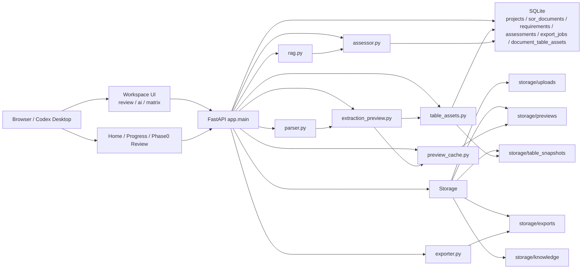

# 项目现状与系统架构

适用仓库：`/Users/liuchang/Documents/New project`

这份文档以当前代码为准，覆盖：

- 当前系统真实实现状态
- 实际架构与关键数据流
- 已落地能力与主要技术债
- 后续优化计划与分支优先级
- Codex 并行开发槽位

如果本文和旧 PRD / 数据库设计文档有冲突，以本文和代码为准。

## 1. 当前项目状态

当前项目已经从“单页原型”演进为一套可运行的 `FastAPI + 原生前端 + SQLite + 文件资产存储` 系统，核心能力已经落地：

- 统一工作台 `workspace`
  - 条目审阅
  - 锁定条目集
  - AI 分析
  - Compliance Matrix 导出
- 预览缓存
  - preview 已从同步重算改为文档级缓存
  - review / lock / export 不再依赖实时重建 preview
- 表格资产化
  - requirement 支持 `table_refs`
  - 文档级表格资产保存到 `document_table_assets`
  - Web / Excel 优先消费同一份表格切片资产
- 导出链路
  - 导出前要求条目集已锁定
  - Excel 由 `xlsxwriter` 生成
  - 表格内容支持图片插入
- 工作流状态
  - 支持条目集锁定
  - 支持锁定后编辑自动解锁
  - 支持 AI 状态与知识库版本联动

## 2. 当前系统架构

## 3. 代码对齐后的关键模块

### 3.1 后端入口

主入口：`/Users/liuchang/Documents/New project/prototype/app/main.py`

当前对外核心页面与接口：

- `GET /`
- `GET /workspace`
- `GET /project-progress`
- `GET /phase0-review`
- `GET /api/projects/{project_id}/sor-documents/{document_id}/workspace`
- `POST /api/projects/{project_id}/sor-documents/{document_id}/review-entry`
- `POST /api/projects/{project_id}/sor-documents/{document_id}/lock-extraction`
- `POST /api/projects/{project_id}/sor-documents/{document_id}/run-ai-analysis`
- `POST /api/projects/{project_id}/sor-documents/{document_id}/refresh-preview`
- `POST /api/projects/{project_id}/export`
- `GET /api/projects/{project_id}/sor-documents/{document_id}/table-assets/{table_id}`
- `GET /api/projects/{project_id}/sor-documents/{document_id}/table-assets/{table_id}/snapshot`

### 3.2 数据与状态

核心数据库文件：`/Users/liuchang/Documents/New project/prototype/app/db.py`

当前真实持久化重点：

- `projects`
- `sor_documents`
  - 包含 `preview_status / preview_generated_at / preview_file_mtime / preview_error`
- `requirements`
  - 包含 `table_refs / content_blocks / has_table_asset / table_render_mode`
- `assessments`
- `evidences`
- `export_jobs`
- `document_table_assets`

### 3.3 预览与表格资产

当前不是“每次请求都实时重建文档结构”，而是：

1. 上传/刷新时构建 preview
2. preview 落盘到 `storage/previews`
3. preview 构建时补齐表格资产
4. 工作台读取 `workspace` 轻量数据
5. review 阶段单独消费 preview / table asset

表格资产的当前真实定位：

- 人类展示：截图 / 表格切片
- Excel 导出：复用同一份切片资产
- AI：已经有 `slice_ai_projection` 基础字段，但主链还没有完全切过去

## 4. 当前工作流

### 4.1 文档到工作台

1. 上传 SOR
2. `parse_document(...)`
3. 持久化 `sor_documents`
4. 触发 `request_preview_refresh(...)`
5. `build_extraction_preview(...)`
6. `enrich_entries_with_table_assets(...)`
7. 缓存 preview + 写入 `document_table_assets`
8. 工作台加载 `workspace`

### 4.2 审阅与锁定

1. review 阶段修改 `keep / entry_kind`
2. `review-entry` 持久化 requirement
3. 如已锁定，则自动解锁
4. 重新锁定后，才允许导出或运行 AI

### 4.3 AI 分析

1. 条目集锁定
2. `run-ai-analysis`
3. `retrieve_evidence(...)`
4. `assess_requirement(...)`
5. 写入 `assessments / evidences`

### 4.4 导出

1. 检查当前文档已锁定
2. 从 `workspace.requirements` 组装当前快照
3. 交给 `export_compliance_matrix(...)`
4. 导出到 `storage/exports`

## 5. 当前技术债与问题分层

### A. 表格链路

当前最大的不稳定点仍然是表格：

- 大表拆条后的单条 requirement，并不总能稳定映射回高保真切片
- 有些条目在 Web 中能看到结构表，但 Excel 中仍然只能部分还原
- `slice_ai_projection` 已具备基础，但 AI 主链还没有完全消费它

### B. 工作台性能

当前慢点主要集中在前端：

- review 列表一次性渲染内容过重
- Windows 浏览器对长列表 + 图片 +表格更敏感
- 虚拟滚动还没有正式落地

### C. 文档与实现脱节

旧 `v1` 设计文档主要是“目标态说明”，不是当前代码的真实镜像：

- 旧 PRD 偏产品愿景
- 旧数据/API 文档偏概念设计
- 当前真正准确的实现说明，需要依赖这份文档和代码本身

## 6. 后续优化计划（按优先级）

### P0：表格资产主线

分支：`codex/table-assets-mainline`  
目录：`/Users/liuchang/Documents/New project/worktrees/_active/table-assets-mainline`

目标：

- 停止 markdown 往返作为表格真相源
- requirement 统一依赖 `table_ref + slice_snapshot + slice_ai_projection`
- 补齐大表拆条的切片覆盖，重点覆盖附件类 `1~46` 这种条目
- 保证 Web 与 Excel 使用同一份表格资产

成功标准：

- Web 审阅与 Excel 导出对同一 requirement 的表格展示一致
- 大表拆条不再依赖 markdown 回表

### P1：工作台稳定性与性能

分支：`codex/workspace-stabilization`  
目录：`/Users/liuchang/Documents/New project/worktrees/_active/workspace-stabilization`

目标：

- 落地 review 列表虚拟滚动
- 优化 Windows 浏览器卡顿
- 继续压缩 preview / review 渲染成本
- 收紧锁定/导出/AI 的状态一致性

成功标准：

- 首屏进入和 review 滚动明显平滑
- 审阅保存、锁定、导出不再出现“看起来无响应”

### P2：AI 切到表格切片上下文

分支：`codex/ai-slice-integration`  
目录：`/Users/liuchang/Documents/New project/worktrees/_active/ai-slice-integration`

目标：

- AI 输入切到 `slice_ai_projection + requirement 正文 + section context`
- 不再依赖 markdown 回表
- 保持证据链和人工审计可追溯

成功标准：

- AI 对表格型 requirement 的输入更稳定
- 不再需要为了 AI 读表而牺牲人类展示效果

### P3：扫描件/OCR

当前暂缓，不进入活跃开发线。

## 7. Codex 并行开发槽位

当前建议保持 3 条活跃开发线，对应 3 个 Codex 窗口/会话：

1. `table-assets-mainline`
2. `workspace-stabilization`
3. `ai-slice-integration`

主仓库 `main` 保持稳定基线，不作为高风险开发槽位。

> 说明：终端和 git 可以准备好 3 个 worktree，但 Codex 桌面应用本身没有稳定的“从 shell 直接创建 GUI thread”接口。实践上应理解为：先准备好 3 个 worktree，再分别在 Codex 里打开 3 个窗口/会话。

## 8. 关于 Claude Code / OpenClaw / 其他 Agent

当前本机已可直接在 terminal 调用：

- `claude`
- `openclaw`
- `opencode`
- `codex`

结论：

- 可以在 terminal 调用它们
- 也可以把低优先级、低风险、边界清楚的任务交给它们
- 但必须遵守同一条规则：
  - **一个 agent 一个 worktree**

推荐委派给其他 agent 的任务：

- 文档整理
- 批量静态重构
- UI 文案与样式微调
- 非关键实验性页面

不建议直接外包的任务：

- 解析/拆解核心逻辑
- 表格资产化主线
- 导出链路
- 锁定/AI 状态机

原因很简单：这些部分的系统耦合高，错误成本高，必须由主线开发严格控制。
