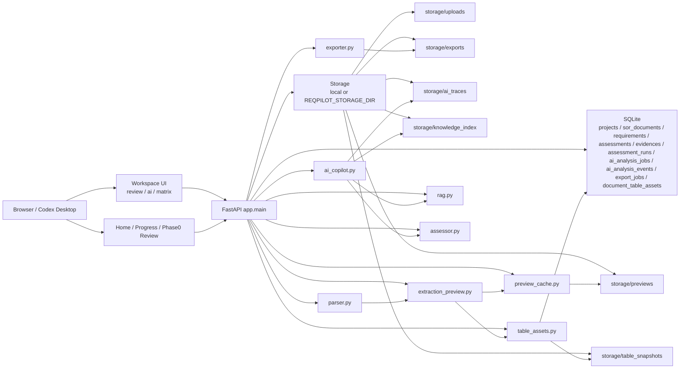

# 项目现状与系统架构

更新时间：2026-04-01 13:42 CST  
适用仓库：`/Users/liuchang/Documents/New project`

这份文档是当前仓库的总入口，记录：

- 当前真实实现状态
- 当前主线、维护线与外部依赖
- 模块级盘点：已完成 / 待开发 / 待完善 / 待测试
- 当前文档地图，避免继续被旧文档误导

如果本文、`active-context`、旧 PRD、旧 backlog 与代码有冲突，以代码和本文为准。

## 1. 文档地图

### 1.1 当前真相源

- 总体状态与模块盘点：
  - `/Users/liuchang/Documents/New project/docs/项目.md`
- 当前执行清单：
  - `/Users/liuchang/Documents/New project/docs/开发执行清单.md`
- Azure 公司环境接手：
  - `/Users/liuchang/Documents/New project/docs/Azure环境接手清单.md`
- 当前活跃上下文：
  - `/Users/liuchang/Documents/New project/docs/active-context.md`
  - `/Users/liuchang/Documents/New project/prototype/docs/extraction-active-context.md`
- Git / worktree 协作规范：
  - `/Users/liuchang/Documents/New project/docs/codex-git-workflow.md`

### 1.2 历史文档 / 方案文档

以下文档保留参考价值，但不再代表“当前已实现状态”：

- `/Users/liuchang/Documents/New project/docs/sor-ai-app-prd-v1.md`
- `/Users/liuchang/Documents/New project/docs/sor-ai-app-data-api-v1.md`
- `/Users/liuchang/Documents/New project/docs/sor-ai-app-ai-prompts-rules-v1.md`
- `/Users/liuchang/Documents/New project/prototype/docs/p0_p1_execution_backlog.md`
- `/Users/liuchang/Documents/New project/prototype/docs/prd_preventive_section_split_engine_v1.md`

使用方式：

- 看“现在系统做到哪一步”：优先看本文和 `active-context`
- 看“接下来谁做什么、如何验收”：看 `docs/开发执行清单.md`
- 看“切到公司网络后怎么继续做 Azure 联调”：看 `docs/Azure环境接手清单.md`
- 看“早期目标与设计意图”：再回看 `v1` 文档
- 看“章节拆解专项方案”：再看 preventive-section-split 文档

## 2. 当前项目总览

当前项目已经从“拆 PDF 的原型工具”演进成一套可运行的 `FastAPI + 原生前端 + SQLite + 文件资产存储` 系统，主流程已经闭环：

1. 上传 SOR 与 knowledge docs
2. 构建 extraction preview
3. 审阅条目并锁定 requirement set
4. 运行 AI screening / assessment
5. 人工改判 `final_decision`
6. 导出 Compliance Matrix

当前开发阶段已经拆成五条线：

- 当前近端主线：`local server operations / production foundation`
  - 第一阶段不做全量重写，先把本地 `8000` 服务的 `settings + secret + readiness + observability + AI job reliability` 收口
  - 当前阶段先本地运维一段时间，保持 AI/Azure baseline 可复跑，不继续推进云端宿主部署
- 云端预留落地线：`Azure App Service`
  - Azure App Service 单实例 pilot 仍是既定云端技术目标，但当前已暂停，等待正式放行和权限申请窗口开启后恢复
  - 未恢复前不继续 `azd provision --preview`、`azd up` 或托管身份云端验证
- AI/RAG 质量线：`screening / retrieval / assessment / evidence`
  - 目标从“辅助建议”升级为“自动生成并落库 `ai_decision`”
  - 当前 `llm_shadow + azure_sdk` live 基线与真实样本 `sample10` benchmark 都已验证通过；后续重点转到人工抽查、阈值收口、Azure AI Search 调优与 `llm_primary` 评估
- UX 线：`workspace / review / matrix / evidence inspector`
  - Windows 下的滑动卡顿与模块 layout friction 已明确记录，不再只当作零散体验反馈
  - 后续要把 review 大表、matrix、AI stage、PDF/evidence 联动的可用性作为近端任务收口
- 迁移评估线：`managed DB / Azure Blob Storage / Azure Document Intelligence`
  - 当前先记录路线，不把大规模数据层和 parser 切换混进首发 pilot gate
  - 关系型状态与文件资产会分开规划：前者迁往托管 Azure 数据库，后者迁往 Azure Blob Storage
- 维护线：`extraction / preview / table-assets`
  - 章节顺序与核心截图问题已基本收口
  - 只处理明确回归，不再主动重构

当前推荐的执行方式是：先把首发 pilot 的运行底座与质量门禁做实，再把 UI 优化、Search 调优、数据库/存储迁移、Document Intelligence 评估放进有验收口径的后续阶段，而不是继续堆“以后再看”的泛 backlog。

## 3. 当前真实架构

### 3.1 当前 Azure 落地基线

- 仓库根目录已有 `azure.yaml + infra/`，当前目标宿主是 Azure App Service Linux Web App
- 运行时已经支持 `REQPILOT_STORAGE_DIR`，可以把 `uploads / previews / exports / ai_traces / knowledge_index` 重定向到云端持久化目录
- `managed_identity` 已作为 `REQPILOT_AZURE_AUTH_MODE` 的表达别名接入现有 RBAC 逻辑，便于 App Service 直接声明托管身份模式
- 在 SQLite + 进程内后台线程替换前，Azure 侧实例数必须保持 `1`；当前所有上线计划都按单实例 pilot 编排

当前 AI 分析链路已经变成：

1. screening：先标 `REQUIREMENT / INFO`
2. assessment：只分析 `REQUIREMENT`
3. trace：保存本次 input / output / fallback / mode

其中：

- `INFO` 条目继续保留在 Compliance Matrix
- 但 `INFO` 不再进入 retrieval / decision
- 没有 knowledge docs 时，也可以先完成 screening
- 非 Azure 路径当前已具备本地生产可用形态：
  - `chunk + metadata boost` 本地 retrieval
  - 第一轮 hard-rule reconciler
  - `assessment_runs + ai_traces`
  - `ai_smoke_suite + table_asset_regression_gate`

## 4. 模块盘点

### 4.1 已完成并可用

#### A. 文档解析与审阅主链

- `prototype/app/services/parser.py`
- `prototype/app/services/extractor.py`
- `prototype/app/services/extraction_preview.py`
- `prototype/app/services/preview_cache.py`
- `prototype/app/main.py`
- `prototype/app/static/extraction-review.*`

当前状态：

- 文档可解析为 preview + reviewed entries
- 支持条目审阅、编辑、锁定、解锁
- preview 已缓存化，不再每次请求重建

#### B. 表格资产主链

- `prototype/app/services/table_assets.py`
- `prototype/app/services/complex_table_mode.py`
- `prototype/app/db.py`
- `prototype/app/static/app.js`

当前状态：

- requirement 支持 `table_refs / content_blocks / slice_ai_projection`
- document 级表格资产已持久化
- Web / preview / export 已共享同一套表格资产
- 已修复一批关键截图问题，包括 `W` 空白、`U:46`、`U:94`、`U:96`、油泵 PDS 第 30 页缺失

#### C. Workspace / Matrix / Export

- `prototype/app/static/index.html`
- `prototype/app/static/app.js`
- `prototype/app/services/exporter.py`

当前状态：

- 支持主工作台
- 支持人工改判、批量判定模板、导出 Compliance Matrix
- 导出要求条目集已锁定
- knowledge docs 上传 UI 已支持 `doc_type / doc_version / status / effective dates`
- 矩阵中的 `INFO` 行现在支持人工覆盖为 `REQUIREMENT` 并重新进入 AI 分析
- 页面已新增知识文档清单，方便直接核对 metadata 与 retrieval sync 状态

#### D. AI 基础链路

- `prototype/app/services/ai_copilot.py`
- `prototype/app/services/rag.py`
- `prototype/app/services/assessor.py`
- `prototype/app/db.py`

当前状态：

- 支持 screening / assessment / evidence / assessment_runs / ai traces
- 支持 `heuristic / llm_shadow / llm_primary`
- 当前默认仍可用 `heuristic + local retrieval`
- 本地 heuristic 路径已升级为 chunk 级 retrieval、metadata weighting、hard-rule 收口
- 本地非 Azure 核心回归当前顺序通过 `270` 条；AI smoke `6/6`，table gate `137/137`
- Azure live 路径当前已验证：screening、embedding、Azure Search index upsert、retrieval、`llm_shadow`
- `prototype/scripts/azure_rag_smoke.py` 现已兼作真实 benchmark harness，并支持 `--max-requirements` 抽样；外部真实样本 `sample10` 已绿色通过

### 4.2 待扩展模块

这些是主线已打通、但还需要继续扩大覆盖或做升级决策的模块。

#### A. 真实 Azure benchmark 扩面

模块：

- `prototype/app/services/ai_copilot.py`
- `prototype/scripts/azure_rag_smoke.py`

当前缺口：

- `llm_shadow + azure_sdk` live 基线已完成
- 外部真实样本 `sample10` 已通过，但当前只形成了最小可信 benchmark 面
- 当前真实 benchmark 资产仍是混合状态：评测入口和部分知识资产已在工作区内，业务样本 `sample10` 仍依赖外部或共享可访问路径

目标：

- 扩到更多 requirement 类型、补人工抽查结论，并逐步收口评测阈值

#### B. Azure AI Search 检索质量调优

模块：

- `prototype/app/services/ai_copilot.py`
- `prototype/app/services/rag.py`
- `prototype/scripts/azure_rag_smoke.py`

当前缺口：

- 当前 Azure AI Search 已完成联通与 hybrid retrieval 基线，但“接通”不等于“检索质量稳定”
- 真实样本 `sample10` 虽已绿色通过，但 evidence relevance 仍偏低，尚未形成系统性的 tuning 闭环
- chunking、metadata filter、semantic configuration、hybrid threshold、reranker score 解读、facet 驱动 query 仍缺专门调优与验收标准

目标：

- 把 Azure AI Search 从“可用”推进到“可调优、可评测、可回归”
- 为 evidence relevance 建立明确的 benchmark 与人工抽查口径
- 把 search tuning 结果沉淀成可复跑的 smoke/eval 配置，而不是只依赖临场观察

#### C. 关系型数据与文件资产云迁移路线

模块：

- `prototype/app/db.py`
- `prototype/app/runtime_paths.py`
- `azure.yaml`
- `infra/*`

当前缺口：

- 当前单实例 pilot 仍以 SQLite + 本地文件系统语义为主，只是通过 `REQPILOT_STORAGE_DIR` 给云端持久化留了入口
- 关系型状态、上传文件、preview、exports、traces 当前还没有拆成独立云端存储策略
- 在不替换 SQLite 与本地文件语义的前提下，不适合直接走多实例或更强的生产级伸缩

目标：

- 明确把关系型状态与文件资产分成两条迁移路线
- 关系型状态迁往托管 Azure 数据库，文件资产迁往 Azure Blob Storage
- 为后续迁移准备 decision record、分阶段 rollout 与 rollback/coexistence 方案

#### D. Azure Document Intelligence 影子评估

模块：

- `prototype/app/services/parser.py`
- `prototype/app/services/extractor.py`
- `prototype/app/services/extraction_preview.py`
- `docs/Azure环境接手清单.md`

当前缺口：

- 当前 parser 主链已经稳定到可支撑首发 pilot，但仍是本地解析链路，不是 Azure 原生文档解析能力
- Azure Document Intelligence 尚未在代表性样本上做 extraction fidelity、成本、时延、fallback 复杂度的影子评估

目标：

- 首发 pilot 保持当前 parser 主链，不把 parser 替换混入当前上线 gate
- 在真实样本上对 Azure Document Intelligence 做 shadow evaluation
- 只有在质量、成本、时延与 fallback 设计都可接受时，才决定是否进入正式迁移阶段

#### E. `llm_primary` 升级评估

模块：

- `prototype/app/services/ai_copilot.py`
- `docs/Azure环境接手清单.md`

当前缺口：

- `llm_primary` 仍未做 live 验证
- 还缺基于真实 benchmark 的人工抽查结论与升级/回退策略

目标：

- 在 `QA-01` 收口后，明确是否从 `llm_shadow` 升级到 `llm_primary`

### 4.3 待完善模块

这些模块已经可用，但还不够成熟。

#### A. Rule Engine 收口能力

模块：

- `prototype/app/services/ai_copilot.py`
- `prototype/app/services/assessor.py`

待完善点：

- 法规红线的领域规则仍需继续补齐
- 明确禁配词典与更细粒度 override 仍待补
- 当前已完成第一轮收口：
  - 冲突证据默认 `NEED_CLARIFICATION`
  - 无负向证据不得直接 `REJECT`
  - 法规类缺少 compliance signal 时不得正向判定

#### B. Workspace 产品体验

模块：

- `prototype/app/static/app.js`
- `prototype/app/static/styles.css`

待完善点：

- AI 结果列的状态表达还可以继续压缩
- screening-only / 未分析 / 已分析 的提示还可进一步区分
- 知识文档 metadata 与 AI 状态的总览还可以继续产品化
- Windows 下 review / matrix / AI stage 的滑动卡顿仍明显，尤其是大文档和大表格场景
- workspace 内部 layout 仍需细化：review 主表、detail inspector、evidence chain、knowledge docs 列表之间的空间关系还不够稳定
- 需要把滚动、重绘、overflow 和 sticky 区域的性能问题显式化，而不是只做视觉层面的样式微调

#### C. 服务状态与运维脚本

模块：

- `prototype/start.sh`
- `prototype/status.sh`
- `prototype/stop.sh`

待完善点：

- 本地 `start -> status -> stop` 已通过 smoke
- 后续主要是继续补跨端口、多实例和异常退出场景

#### D. 表格链路维护性

模块：

- `prototype/app/services/table_assets.py`
- `prototype/app/services/extraction_preview.py`

待完善点：

- 主线已经稳定，且已补 `table_asset_regression_gate`
- 新样本进入时，仍依赖人工点号复核关键截图

### 4.4 待测试 / 待验收模块

#### A. Azure 全链路验收

必须验证：

- screening 调 Azure OpenAI
- embedding 调 Azure OpenAI
- Azure AI Search index upsert
- Azure AI Search hybrid retrieval
- `llm_shadow`
- `llm_primary`

当前状态：

- screening / embedding / index upsert / hybrid retrieval / `llm_shadow` 已在公司网络 live 验证
- 外部真实样本 `sample10` 已通过，最小可信 benchmark 面已具备

当前 blocker：

- `llm_primary` 仍未 live 验证
- 真实 benchmark 资产仍是混合状态；跨机器复跑前仍需把业务样本与知识参考文件统一到工作区或共享可访问路径
- Azure AI Search 的联通基线已完成，但检索质量调优仍未形成专项验收闭环

#### B. RAG 质量验收集

需要补齐的样本类型：

- 纯文本 requirement
- 表格 requirement
- 法规 requirement
- evidence 冲突 requirement
- 无有效 evidence requirement
- `INFO` / 非真实需求 requirement

当前状态：

- 本地 smoke 与回归门禁已建立
- Azure live benchmark 已形成最小可信面；待补的是人工抽查、评测阈值与更广样本覆盖

#### C. Compliance Matrix 结果验收

需要人工确认：

- `INFO` 条目在矩阵中的呈现是否符合业务预期
- `screening_only` 条目是否需要显式标识“待知识库分析”
- `final_decision` 对 `INFO` 是否继续保持空白/禁用

## 5. 当前优先级排序

### P0：本地服务器运维与生产底座稳定

1. 收口 `settings + secret + readiness + observability + AI job reliability`
2. 完成 smoke DB 隔离，稳定本地 `8000` 服务运维口径与单实例运行约束
3. 基于已通过的 `sample10` 收口人工抽查与评测阈值
4. 保持 `llm_shadow + azure_sdk` 作为当前 live 基线，并确保 smoke/benchmark 可复跑

### P1：质量与用户可用性收口

1. 规则收口继续补领域规则
2. Windows 下的 review / matrix / AI stage 滑动性能与 layout 细节优化
3. Azure AI Search 检索质量调优与 evidence relevance 收口
4. 把真实 benchmark 文件与复跑脚本收口成稳定验收入口
5. 满足条件后再评估是否切到 `llm_primary`

### P2：正式放行后的云端恢复与迁移决策

1. 恢复 Azure App Service preview / provision / 托管身份验证
2. 明确关系型状态迁往托管 Azure 数据库的方案与边界
3. 明确上传文件、preview、exports、traces 迁往 Azure Blob Storage 的方案与边界
4. 对 Azure Document Intelligence 做 shadow evaluation，并给出是否迁移 parser 的决策依据

### P3：后续增强

- OCR / 扫描件专项
- 更强 reranker
- 更细粒度的评测与门禁
- 在 job/data 架构替换后再评估多实例与更大规模生产化

## 6. 推荐的当前文档使用方式

如果你是：

- 产品 / 项目管理：
  - 先看本文第 4 节和第 5 节
- 开发：
  - 先看本文 + `active-context`
- 新开 Codex 窗口：
  - 先看 `docs/active-context.md`
  - 再看 `prototype/docs/extraction-active-context.md`
- 回顾老方案：
  - 再看 `v1` PRD / 数据设计 / prompts 文档

## 7. 当前运行入口

- 稳定服务端口：`8000`
- 启动：
  - `cd /Users/liuchang/Documents/New project/prototype && ./start.sh`
- 状态：
  - `cd /Users/liuchang/Documents/New project/prototype && ./status.sh`
- 停止：
  - `cd /Users/liuchang/Documents/New project/prototype && ./stop.sh`
