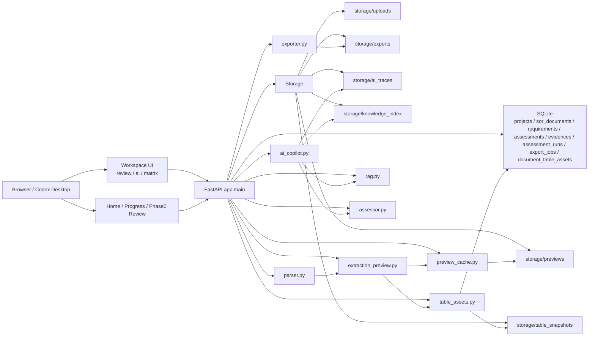

# 项目现状与系统架构

更新时间：2026-03-31  
适用仓库：`/Users/liuchang/Documents/New project`

这份文档是当前仓库的总入口，记录：

- 当前真实实现状态
- 当前主线、维护线与外部依赖
- 模块级盘点：已完成 / 待开发 / 待完善 / 待测试
- 当前文档地图，避免继续被旧文档误导

如果本文、`active-context`、旧 PRD、旧 backlog 与代码有冲突，以代码和本文为准。

## 1. 文档地图

### 1.1 当前真相源

- 总体状态与模块盘点：
  - `/Users/liuchang/Documents/New project/docs/项目.md`
- 当前执行清单：
  - `/Users/liuchang/Documents/New project/docs/开发执行清单.md`
- Azure 公司环境接手：
  - `/Users/liuchang/Documents/New project/docs/Azure环境接手清单.md`
- 当前活跃上下文：
  - `/Users/liuchang/Documents/New project/docs/active-context.md`
  - `/Users/liuchang/Documents/New project/prototype/docs/extraction-active-context.md`
- Git / worktree 协作规范：
  - `/Users/liuchang/Documents/New project/docs/codex-git-workflow.md`

### 1.2 历史文档 / 方案文档

以下文档保留参考价值，但不再代表“当前已实现状态”：

- `/Users/liuchang/Documents/New project/docs/sor-ai-app-prd-v1.md`
- `/Users/liuchang/Documents/New project/docs/sor-ai-app-data-api-v1.md`
- `/Users/liuchang/Documents/New project/docs/sor-ai-app-ai-prompts-rules-v1.md`
- `/Users/liuchang/Documents/New project/prototype/docs/p0_p1_execution_backlog.md`
- `/Users/liuchang/Documents/New project/prototype/docs/prd_preventive_section_split_engine_v1.md`

使用方式：

- 看“现在系统做到哪一步”：优先看本文和 `active-context`
- 看“接下来谁做什么、如何验收”：看 `docs/开发执行清单.md`
- 看“切到公司网络后怎么继续做 Azure 联调”：看 `docs/Azure环境接手清单.md`
- 看“早期目标与设计意图”：再回看 `v1` 文档
- 看“章节拆解专项方案”：再看 preventive-section-split 文档

## 2. 当前项目总览

当前项目已经从“拆 PDF 的原型工具”演进成一套可运行的 `FastAPI + 原生前端 + SQLite + 文件资产存储` 系统，主流程已经闭环：

1. 上传 SOR 与 knowledge docs
2. 构建 extraction preview
3. 审阅条目并锁定 requirement set
4. 运行 AI screening / assessment
5. 人工改判 `final_decision`
6. 导出 Compliance Matrix

当前开发阶段分成两条线：

- 维护线：`extraction / preview / table-assets`
  - 章节顺序与核心截图问题已基本收口
  - 只处理明确回归，不再主动重构
- 主线：`AI 分析模块`
  - 目标从“辅助建议”升级为“自动生成并落库 `ai_decision`”
  - 当前已完成 screening + assessment 骨架、trace、Azure 双模式接入
  - 真实 Azure 联通验证仍依赖公司网络环境

## 3. 当前真实架构

当前 AI 分析链路已经变成：

1. screening：先标 `REQUIREMENT / INFO`
2. assessment：只分析 `REQUIREMENT`
3. trace：保存本次 input / output / fallback / mode

其中：

- `INFO` 条目继续保留在 Compliance Matrix
- 但 `INFO` 不再进入 retrieval / decision
- 没有 knowledge docs 时，也可以先完成 screening
- 非 Azure 路径当前已具备本地生产可用形态：
  - `chunk + metadata boost` 本地 retrieval
  - 第一轮 hard-rule reconciler
  - `assessment_runs + ai_traces`
  - `ai_smoke_suite + table_asset_regression_gate`

## 4. 模块盘点

### 4.1 已完成并可用

#### A. 文档解析与审阅主链

- `prototype/app/services/parser.py`
- `prototype/app/services/extractor.py`
- `prototype/app/services/extraction_preview.py`
- `prototype/app/services/preview_cache.py`
- `prototype/app/main.py`
- `prototype/app/static/extraction-review.*`

当前状态：

- 文档可解析为 preview + reviewed entries
- 支持条目审阅、编辑、锁定、解锁
- preview 已缓存化，不再每次请求重建

#### B. 表格资产主链

- `prototype/app/services/table_assets.py`
- `prototype/app/services/complex_table_mode.py`
- `prototype/app/db.py`
- `prototype/app/static/app.js`

当前状态：

- requirement 支持 `table_refs / content_blocks / slice_ai_projection`
- document 级表格资产已持久化
- Web / preview / export 已共享同一套表格资产
- 已修复一批关键截图问题，包括 `W` 空白、`U:46`、`U:94`、`U:96`、油泵 PDS 第 30 页缺失

#### C. Workspace / Matrix / Export

- `prototype/app/static/index.html`
- `prototype/app/static/app.js`
- `prototype/app/services/exporter.py`

当前状态：

- 支持主工作台
- 支持人工改判、批量判定模板、导出 Compliance Matrix
- 导出要求条目集已锁定
- knowledge docs 上传 UI 已支持 `doc_type / doc_version / status / effective dates`
- 矩阵中的 `INFO` 行现在支持人工覆盖为 `REQUIREMENT` 并重新进入 AI 分析
- 页面已新增知识文档清单，方便直接核对 metadata 与 retrieval sync 状态

#### D. AI 基础链路

- `prototype/app/services/ai_copilot.py`
- `prototype/app/services/rag.py`
- `prototype/app/services/assessor.py`
- `prototype/app/db.py`

当前状态：

- 支持 screening / assessment / evidence / assessment_runs / ai traces
- 支持 `heuristic / llm_shadow / llm_primary`
- 当前默认仍可用 `heuristic + local retrieval`
- 本地 heuristic 路径已升级为 chunk 级 retrieval、metadata weighting、hard-rule 收口
- 本地非 Azure 核心回归当前顺序通过 `270` 条；AI smoke `6/6`，table gate `137/137`

### 4.2 待开发模块

这些是还没真正完成、但已经明确进入主线的模块。

#### A. 真实 Azure screening 联通

模块：

- `prototype/app/services/ai_copilot.py`

当前缺口：

- RBAC 代码路径已接好
- 但还没有在公司网络下完成 live Azure OpenAI screening 验证

目标：

- 让 `INFO / REQUIREMENT` 预筛真正由 Azure OpenAI 小模型承担

#### B. 真实 Azure retrieval / index upsert

模块：

- `prototype/app/services/ai_copilot.py`
- `prototype/app/db.py`

当前缺口：

- 已支持两条接入路径：
  - `azure_haystack`：API key
  - `azure_sdk`：RBAC
- 但还没做真实 `index upsert / search / semantic rerank / vector query` 验证

目标：

- 用 Azure AI Search 替换当前主线中的本地 heuristic retrieval

### 4.3 待完善模块

这些模块已经可用，但还不够成熟。

#### A. Rule Engine 收口能力

模块：

- `prototype/app/services/ai_copilot.py`
- `prototype/app/services/assessor.py`

待完善点：

- 法规红线的领域规则仍需继续补齐
- 明确禁配词典与更细粒度 override 仍待补
- 当前已完成第一轮收口：
  - 冲突证据默认 `NEED_CLARIFICATION`
  - 无负向证据不得直接 `REJECT`
  - 法规类缺少 compliance signal 时不得正向判定

#### B. Workspace 产品体验

模块：

- `prototype/app/static/app.js`
- `prototype/app/static/styles.css`

待完善点：

- AI 结果列的状态表达还可以继续压缩
- screening-only / 未分析 / 已分析 的提示还可进一步区分
- 知识文档 metadata 与 AI 状态的总览还可以继续产品化

#### C. 服务状态与运维脚本

模块：

- `prototype/start.sh`
- `prototype/status.sh`
- `prototype/stop.sh`

待完善点：

- 本地 `start -> status -> stop` 已通过 smoke
- 后续主要是继续补跨端口、多实例和异常退出场景

#### D. 表格链路维护性

模块：

- `prototype/app/services/table_assets.py`
- `prototype/app/services/extraction_preview.py`

待完善点：

- 主线已经稳定，且已补 `table_asset_regression_gate`
- 新样本进入时，仍依赖人工点号复核关键截图

### 4.4 待测试 / 待验收模块

#### A. Azure 全链路验收

必须验证：

- screening 调 Azure OpenAI
- embedding 调 Azure OpenAI
- Azure AI Search index upsert
- Azure AI Search hybrid retrieval
- `llm_shadow`
- `llm_primary`

当前 blocker：

- 开发环境不在公司网络
- 需要公司网络或可用的 service principal / VPN / jump 环境

#### B. RAG 质量验收集

需要补齐的样本类型：

- 纯文本 requirement
- 表格 requirement
- 法规 requirement
- evidence 冲突 requirement
- 无有效 evidence requirement
- `INFO` / 非真实需求 requirement

当前状态：

- 本地 smoke 与回归门禁已建立
- 待补的主要是 Azure live benchmark，不再是本地样本缺口

#### C. Compliance Matrix 结果验收

需要人工确认：

- `INFO` 条目在矩阵中的呈现是否符合业务预期
- `screening_only` 条目是否需要显式标识“待知识库分析”
- `final_decision` 对 `INFO` 是否继续保持空白/禁用

## 5. 当前优先级排序

### P0：AI 主线落地

1. 公司网络下完成 Azure RBAC 联通
2. 跑通 Azure OpenAI screening
3. 跑通 Azure AI Search index / retrieval
4. 先切 `llm_shadow`
5. 评测通过后再切 `llm_primary`

### P1：知识库与人工流程补强

1. 规则收口继续补领域规则
2. 评测集与 Azure 验收基线完善
3. Azure metadata filter 的真实云端验证

### P2：工作台与运维完善

1. UI 状态与审计展示继续压缩
2. 长列表 / 大文档性能继续优化
3. 表格链路基线维护继续制度化（本地回归门禁已落地）

### P3：后续增强

- OCR / 扫描件专项
- 更强 reranker
- 更细粒度的评测与门禁

## 6. 推荐的当前文档使用方式

如果你是：

- 产品 / 项目管理：
  - 先看本文第 4 节和第 5 节
- 开发：
  - 先看本文 + `active-context`
- 新开 Codex 窗口：
  - 先看 `docs/active-context.md`
  - 再看 `prototype/docs/extraction-active-context.md`
- 回顾老方案：
  - 再看 `v1` PRD / 数据设计 / prompts 文档

## 7. 当前运行入口

- 稳定服务端口：`8000`
- 启动：
  - `cd /Users/liuchang/Documents/New project/prototype && ./start.sh`
- 状态：
  - `cd /Users/liuchang/Documents/New project/prototype && ./status.sh`
- 停止：
  - `cd /Users/liuchang/Documents/New project/prototype && ./stop.sh`
